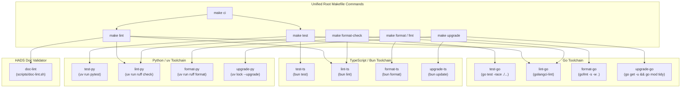

# ADR-003: Polyglot Linter, Formatter, and CI Toolchain Architecture

## Status

**Accepted**

## Context

[`core-kit`](file:///home/dangnmh/work/core-kit) is a polyglot engineering foundation containing code across three language ecosystems:
- Go 1.27+ (`pkg/`)
- TypeScript / Bun 1.4+ (`ts/logger-ts/`)
- Python 3.14+ (`py/logger-py/`)
- HADS 1.0 Documentation (`AGENTS.md`, `llms.txt`, `docs/`)

### Problems & Deficits

1. **Hardcoded Workstation Paths**: The root `Makefile` contained a fragile, machine-specific path:
   ```makefile
   PYTHONPATH=py/logger-py local-venv/bin/pytest py/logger-py/tests -v
   ```
   This breaks on any developer workstation or CI container lacking that exact path.
2. **Missing Documentation Linting Gate**: The BMAD 4-Layer Monorepo HADS Documentation Standard requires that Layer 0 (`AGENTS.md`) and Layer 1 (`docs/<comp>/README.md`) files remain dense and bounded (`<= 120` lines) and maintain 0 broken markdown links. Without automated enforcement, docs degrade and hallucinate.
3. **Disparate Linting Toolchains**:
   - Go: Lacked an explicit `.golangci.yml` file, resulting in 7 unchecked error returns (`errcheck`) in `pkg/httpclient` and `pkg/ws`.
   - TypeScript: Lacked a unified lint and format check command compatible with modern Flat Config (`eslint.config.mjs`).
   - Python: Relied on unstandardized formatting without fast static analysis (e.g. Ruff).
4. **Lack of Cohesive Developer Workflow Targets**: Developers lacked standardized single commands to format, lint, test, or upgrade dependencies across all three languages simultaneously.

## Decision Drivers

- **Zero-Workstation Dependency**: All commands must run identically on Linux, macOS, WSL2, and GitHub Actions CI without hardcoded user directories.
- **Ecosystem-Native Best-in-Class Tools**: Use the fastest, most authoritative tool in each language ecosystem (`golangci-lint` for Go, `Ruff` for Python, `ESLint` + `Bun` for TypeScript).
- **Automated HADS Governance**: Wire `make doc-lint` directly into `make lint` and `make ci` to mechanically prevent documentation bloat and broken links.
- **Convenient Unified Interface**: A single root `Makefile` that dispatches both unified workflows (`make lint`, `make test`, `make format`, `make ci`) and language-scoped targets (`*-go`, `*-ts`, `*-py`).

## Considered Options

### Option 1: Heavy Monorepo Build Tools (Nx, Bazel, Turborepo)
- **Pros**: Advanced task caching and dependency graph visualization.
- **Cons**: Massive dependency footprint (Java/Node requirements for pure Go/Py developers); steep learning curve; overkill for library repository.

### Option 2: Uncoordinated Language-Specific Scripts
- **Pros**: Low barrier to entry for isolated component development.
- **Cons**: High developer friction; CI pipelines duplicate script invocations; cross-language regressions go unnoticed.

### Option 3: Unified Root Makefile Orchestrating Ecosystem-Native Native Toolchains (Selected)
- Use standard GNU `Makefile` at the repository root coordinating standard tools:
  - **Go**: `golangci-lint run ./...` with `.golangci.yml` (version 2) + `gofmt -s -w .`
  - **TypeScript**: `bun lint` (ESLint 9 Flat Config) + `bun test` in `ts/logger-ts`
  - **Python**: `uv run ruff check` & `uv run ruff format` + `uv run pytest` in `py/logger-py`
  - **Documentation**: Dedicated shell validator `scripts/doc-lint.sh` enforcing line limits (`<= 120` lines) and link resolution
  - **Root Targets**: `test`, `lint`, `format` (`fmt`), `format-check`, `upgrade`, `doc-lint`, `ci`.

## Decision

We adopt **Option 3**: Standardize all quality, formatting, testing, and documentation gates under a unified root `Makefile` orchestrating ecosystem-native standard tools.

### Multi-Runtime Toolchain Matrix

| Domain | Lint & Static Analysis | Code Formatter | Test Runner | Dependency Management | Config Location |
| :--- | :--- | :--- | :--- | :--- | :--- |
| **Go 1.27+** | `golangci-lint run ./...` | `gofmt -s` | `go test -race ./...` | `go mod tidy` / `go get -u` | `.golangci.yml` |
| **TypeScript / Bun** | `eslint` (Flat Config) | Prettier / ESLint | `bun test` | `bun update` | `ts/logger-ts/eslint.config.mjs` |
| **Python 3.14+** | `ruff check` | `ruff format` | `pytest` (`uv run pytest`) | `uv lock --upgrade` | `py/logger-py/pyproject.toml` |
| **Docs (HADS 1.0)** | `scripts/doc-lint.sh` | N/A | N/A | N/A | `scripts/doc-lint.sh` |

### Unified Makefile Target Topology



## Consequences

### Positive
- **Deterministic Portability**: Works out of the box in CI and any developer workstation without manual path hacking.
- **Fail-Fast PR Quality**: `make ci` executes in `< 30 seconds`, verifying linting, formatting, documentation integrity, and race-free test execution.
- **Automated HADS Guardrails**: Documentation drift is mechanically blocked at the commit and PR level.

### Negative
- Requires developers working on all three runtimes to have `go`, `bun`, and `uv` (or `python3`) installed locally.
- Sub-targets (`test-go`, `lint-go`, etc.) remain available for developers focusing on a single language stack.

## Related Documents
- [`docs/bmad/02-prd.md`](file:///home/dangnmh/work/core-kit/docs/bmad/02-prd.md) (Epic 1, Story 1.4; Epic 3, Story 3.4)
- [`docs/bmad/04-architecture.md`](file:///home/dangnmh/work/core-kit/docs/bmad/04-architecture.md)
- [`Makefile`](file:///home/dangnmh/work/core-kit/Makefile)
