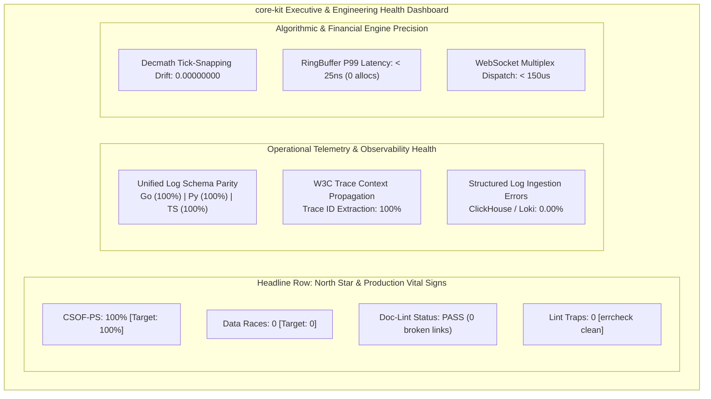

# Product Requirements Document (PRD): Polyglot Foundation Engineering Platform (`core-kit`)

**Document ID**: `BMAD-PRD-02-CORE-KIT`  
**Version**: `1.0.0`  
**Status**: `APPROVED / FROZEN BASELINE`  
**Author**: Role 02: Product Owner / Product Manager (`02-po-manager`)  
**Predecessor Document**: [`docs/bmad/01-project-brief.md`](file:///home/dangnmh/work/core-kit/docs/bmad/01-project-brief.md)  
**Target Next Agents**: Role 04: System Architect (`04-system-architect`), Role 06b: Ecosystem Scout (`06b-ecosystem-scout`), Role 07: Tech Lead (`07-tech-lead`)  
**Repository**: [github.com/dangnmh/core-kit](file:///home/dangnmh/work/core-kit)  
**Date**: 2026-10-16  

---

## 1. Product Overview, Problem Statement & Strategic Objectives

### 1.1 Executive Product Overview
[`core-kit`](file:///home/dangnmh/work/core-kit) is an enterprise-grade polyglot foundation platform providing high-performance, deterministic, zero-alloc engineering primitives, unified distributed telemetry, resilient networking, and financial-precision mathematics across **Go 1.27+**, **Python 3.14+**, and **TypeScript/Bun**.

Extracted from mission-critical real-time streaming engines (`realtime-gateway`) and algorithmic fintech execution systems (`trading-engine`), `core-kit` standardizes the shared infrastructure layer so downstream application services and autonomous AI engineering agents never reinvent boilerplate, struggle with cross-language contract mismatches, or introduce numeric precision and concurrency flaws.

### 1.2 Problem Statement & Current Deficits
While `core-kit` contains 34 Go packages with 100% test pass rate and mature algorithmic logic, a forensic audit revealed four critical systemic problems:
1. **0% Compliance with BMAD 4-Layer HADS Documentation Standard**: The repository lacks root [`AGENTS.md`](file:///home/dangnmh/work/core-kit/AGENTS.md), [`llms.txt`](file:///home/dangnmh/work/core-kit/llms.txt), architectural guides, and per-component READMEs. Developers and autonomous AI agents face cold-start file hunting, burning context window tokens and risking hallucinated contracts.
2. **Polyglot Logging Schema Contract Divergence**: Go (`pkg/logger`) emits top-level JSON attributes using key `"module"`, whereas Python (`py/logger-py`) and TypeScript (`ts/logger-ts`) nest contextual attributes inside `"context": { ... }` and use key `"logger"`. This breaks centralized LogQL/Elastic/ClickHouse queries across multi-service transaction traces.
3. **Internal Redundancy & Anti-Patterns**: Identical code duplicated in [`pkg/idgen`](file:///home/dangnmh/work/core-kit/pkg/idgen) and [`pkg/idutil`](file:///home/dangnmh/work/core-kit/pkg/idutil); [`pkg/llm`](file:///home/dangnmh/work/core-kit/pkg/llm) reinvents string rune truncation with slice allocations instead of reusing [`pkg/strutil.TruncateRunes`](file:///home/dangnmh/work/core-kit/pkg/strutil/strutil.go).
4. **Developer Tooling & Test Runner Blockers**: `ts/logger-ts` mocks `process.stdout.write` globally, which silences Bun test output. `Makefile` has hardcoded local paths and lacks automated doc-linting (`make doc-lint`) and code linting (`make lint`). 7 unhandled error returns trigger linter warnings in `pkg/httpclient` and `pkg/ws`.

### 1.3 Strategic Objectives
- **Obj-1 (Documentation Standard)**: Establish 100% compliance with the 4-Layer Monorepo HADS Documentation Standard (HADS 1.0), enforcing strict line caps (`<= 120` lines for `AGENTS.md` and component READMEs) and 0 broken links.
- **Obj-2 (Polyglot Telemetry Parity)**: Establish a canonical, unified RFC3339 JSON logging contract across Go, Python, and TypeScript, supporting seamless correlation via W3C traceparent headers.
- **Obj-3 (Zero Technical Debt)**: Consolidate duplicate packages, eliminate redundant algorithms in favor of shared utilities (`reuse-over-reinvent`), fix all 7 linter traps, and restore test runner transparency.
- **Obj-4 (Financial & Concurrency Reliability)**: Guarantee zero-data-race concurrency and strict tick-snapped decimal precision across all execution pathways.

---

## 2. North Star Metric & KPI Dashboard Specification

Following the **KPI Dashboard Design** framework, metrics are tiered into Strategic, Tactical, and Operational layers, paired with concrete query formulations and alert thresholds to avoid vanity metrics.

### 2.1 North Star Metric
> **Cross-Service Observability & Foundation Parity Score (CSOF-PS)**  
> Target: **100%**  
> *Formula*: `CSOF-PS = (1 - (Schema_Mismatches + Doc_Broken_Links + Data_Races + Unhandled_Lint_Errors)) * 100%`

### 2.2 KPI Metrics Hierarchy

| Tier | Metric Name | Target | Measurement Method / Query | Update Frequency | Audience |
| :--- | :--- | :---: | :--- | :--- | :--- |
| **Strategic** | **Mean Time to Onboard (MTTO)** | `< 15 mins` | Survey & agent token consumption from repo clone to first passing test and service boot | Monthly | VP Eng / CTO |
| **Strategic** | **Incident Correlation Rate** | `100%` | Ratio of cross-service traces successfully joined across Go, Python, and TypeScript via `trace_id` | Weekly | Platform Architect |
| **Tactical** | **Downstream Service Adoption** | `100%` | Percentage of internal microservices (`realtime-gateway`, `trading-engine`) importing `core-kit` | Bi-weekly | Tech Leads |
| **Tactical** | **Code Test Pass & Coverage** | `100% Pass / >= 80% Stmt` | `go test -race -cover ./...`, `bun test`, `pytest` | Per PR / CI | Engineering Teams |
| **Operational** | **Data Race Count** | `0` | `go test -race ./...` execution across all 34 packages | Continuous (CI) | Senior BE Devs |
| **Operational** | **Doc Integrity & Broken Links** | `0 errors` | `make doc-lint` (checking layer caps & markdown link validity) | Continuous (CI) | Project Librarian |
| **Operational** | **Static Linter Trap Count** | `0 warnings` | `golangci-lint run ./...` (including `errcheck`, `govet`, `staticcheck`) | Continuous (CI) | Senior BE Devs |
| **Operational** | **Hot-Path Allocations** | `0 allocs/op` | Go benchmarks for `ringbuffer.Push`, `decmath.SnapPriceToTick`, `safemap.Get` | Per Release | Fintech / SRE |

### 2.3 Executive Dashboard Layout & Visualization Specification



### 2.4 Concrete LogQL & PromQL Verification Queries

```sql
-- Loki LogQL: Verify 100% of logs across all 3 runtimes contain canonical schema keys
count_over_time({app=~".+"} | json | __error__ != "" [5m]) / count_over_time({app=~".+"} [5m]) == 0

-- LogQL: Cross-Language Trace ID correlation integrity
sum by (service) (rate({service=~"realtime-gateway|trading-engine|core-kit.*"} | json | trace_id != "" [5m]))

-- Prometheus PromQL: Concurrency goroutine leaks during 5-phase graceful shutdown
sum(rate(go_goroutines{job="core-kit-service"}[1m])) <= 5
```

---

## 3. Per-Component Feature Matrix

The following table maps all capabilities and packages across `core-kit` components, establishing their stable identifier, target component prefix, status, and verified code health.

### 3.1 Status Legend
- `✅ Built / Active`: Fully implemented, tested, and active in the codebase.
- `🔄 In-Flight / Refactor`: Functional but requires refactoring, deduplication, or contract standardization.
- `⏸️ Backlog / Deferred`: Formally scoped and deferred to component-specific backlog (`docs/<comp>/backlog/`).

### 3.2 Feature Matrix

| Feature ID | Component Prefix | Package / Subsystem | Capability / Responsibilities | Status | Target Deliverable / Action |
| :--- | :--- | :--- | :--- | :---: | :--- |
| **DOC-01** | `DOC-*` | Root Governance | Layer 0 Constitution ([`AGENTS.md`](file:///home/dangnmh/work/core-kit/AGENTS.md) `<= 120` lines), AI sitemap ([`llms.txt`](file:///home/dangnmh/work/core-kit/llms.txt)), [`README.md`](file:///home/dangnmh/work/core-kit/README.md), [`CHANGELOG.md`](file:///home/dangnmh/work/core-kit/CHANGELOG.md) | `🔄 In-Flight` | Create Layer 0 files |
| **DOC-02** | `DOC-*` | Component Guardrails | Layer 1 Component nearest-wins READMEs ([`docs/pkg/README.md`](file:///home/dangnmh/work/core-kit/docs/pkg), [`docs/py/README.md`](file:///home/dangnmh/work/core-kit/docs/py), [`docs/ts/README.md`](file:///home/dangnmh/work/core-kit/docs/ts)) | `🔄 In-Flight` | Create Layer 1 HADS guides |
| **DOC-03** | `DOC-*` | Architecture Truth | Layer 2 Architecture ([`docs/bmad/04-architecture.md`](file:///home/dangnmh/work/core-kit/docs/bmad)), ADRs ([`docs/adr/ADR-001-*`](file:///home/dangnmh/work/core-kit/docs/adr), [`ADR-002-*`](file:///home/dangnmh/work/core-kit/docs/adr)), and Contracts ([`docs/pkg/contracts/*`](file:///home/dangnmh/work/core-kit/docs/pkg/contracts)) | `🔄 In-Flight` | Author Layer 2 Living Truth |
| **DOC-04** | `DOC-*` | CI Doc Validator | Layer 3 Sprint Deltas & Automated `make doc-lint` script checking broken links and line limits | `🔄 In-Flight` | Implement `scripts/doc-lint.sh` & wire to Makefile |
| **TEL-01** | `CR-*` | [`pkg/logger`](file:///home/dangnmh/work/core-kit/pkg/logger) | Slog JSON handler with dual-mode `"context"` mapping, W3C `trace_id`/`span_id` injection | `🔄 In-Flight` | Harmonize JSON schema with Py/TS |
| **TEL-02** | `PY-*` | [`py/logger-py`](file:///home/dangnmh/work/core-kit/py/logger-py) | Python 3.14+ structured JSON logger, emoji strip, caller tracking, W3C trace header extraction | `🔄 In-Flight` | Add trace context extraction & update docs |
| **TEL-03** | `TS-*` | [`ts/logger-ts`](file:///home/dangnmh/work/core-kit/ts/logger-ts) | TypeScript/Bun JSON logger with child logger context inheritance and trace propagation | `🔄 In-Flight` | Fix test runner stdout mocking & export helpers |
| **TEL-04** | `CR-*` | [`pkg/tracer`](file:///home/dangnmh/work/core-kit/pkg/tracer), [`tracectx`](file:///home/dangnmh/work/core-kit/pkg/tracectx) | OpenTelemetry W3C traceparent carrier injection/extraction, OTLP exporter & request_id propagation | `✅ Built` | Maintain active status |
| **TEL-05** | `CR-*` | [`pkg/httplog`](file:///home/dangnmh/work/core-kit/pkg/httplog) | Rule-based HTTP inbound/outbound logger with PII sanitization (redact, mask, sha256) | `✅ Built` | Maintain active status |
| **CR-01** | `CR-*` | [`pkg/idgen`](file:///home/dangnmh/work/core-kit/pkg/idgen), [`pkg/idutil`](file:///home/dangnmh/work/core-kit/pkg/idutil) | Prefixed hex IDs & NanoID cryptographic generator; consolidate duplicate `idutil` as deprecated alias | `🔄 In-Flight` | Consolidate `idutil` -> `idgen` |
| **CR-02** | `CR-*` | [`pkg/llm`](file:///home/dangnmh/work/core-kit/pkg/llm) | OpenAI client, `GenerateJSON[T]`, `ExtractJSON[T]` thinking-tag stripper (`<think>...`) | `🔄 In-Flight` | Refactor to reuse `pkg/strutil.TruncateRunes` |
| **CR-03** | `CR-*` | [`pkg/httpclient`](file:///home/dangnmh/work/core-kit/pkg/httpclient) | Generic HTTP client (`Get[T]`/`Post[T]`), pool config, proxy support, 429 backoff retry | `🔄 In-Flight` | Fix unhandled `resp.Body.Close()` in tests |
| **CR-04** | `CR-*` | [`pkg/ws`](file:///home/dangnmh/work/core-kit/pkg/ws), [`wsclient`](file:///home/dangnmh/work/core-kit/pkg/wsclient), [`wsserver`](file:///home/dangnmh/work/core-kit/pkg/wsserver) | Sharded multiplexed WebSocket pool, auto-reconnecting client & broadcast server | `🔄 In-Flight` | Fix unhandled `conn.Close()` error returns |
| **CR-05** | `CR-*` | [`pkg/decmath`](file:///home/dangnmh/work/core-kit/pkg/decmath), [`tradecalc`](file:///home/dangnmh/work/core-kit/pkg/tradecalc) | High-precision decimal arithmetic, tick-snapping, slippage, limit IOC calculators | `✅ Built` | Maintain active status |
| **CR-06** | `CR-*` | [`pkg/safemap`](file:///home/dangnmh/work/core-kit/pkg/safemap), [`ringbuffer`](file:///home/dangnmh/work/core-kit/pkg/ringbuffer), [`ttlcache`](file:///home/dangnmh/work/core-kit/pkg/ttlcache) | Zero-alloc thread-safe data structures with atomic compute and background janitor | `✅ Built` | Maintain active status |
| **CR-07** | `CR-*` | [`pkg/priorityqueue`](file:///home/dangnmh/work/core-kit/pkg/priorityqueue), [`quadtree`](file:///home/dangnmh/work/core-kit/pkg/quadtree) | Thread-safe generic Min/Max-Heap & 2D spatial indexing quadtree | `✅ Built` | Maintain active status |
| **CR-08** | `CR-*` | [`pkg/lifecycle`](file:///home/dangnmh/work/core-kit/pkg/lifecycle), [`bootstrap`](file:///home/dangnmh/work/core-kit/pkg/bootstrap), [`config`](file:///home/dangnmh/work/core-kit/pkg/config) | 5-phase Uber Fx graceful shutdown manager, fail-fast config loader with env overrides | `✅ Built` | Maintain active status |
| **CR-09** | `CR-*` | [`pkg/resilience`](file:///home/dangnmh/work/core-kit/pkg/resilience), [`ratelimit`](file:///home/dangnmh/work/core-kit/pkg/ratelimit), [`ticker`](file:///home/dangnmh/work/core-kit/pkg/ticker) | Full-jitter exponential backoff, generic circuit breaker, multi-tier weighted rate limiter | `✅ Built` | Maintain active status |
| **CR-10** | `CR-*` | [`pkg/eventbus`](file:///home/dangnmh/work/core-kit/pkg/eventbus) | In-memory Watermill pub/sub bus with deduplication & timeline audit trail | `✅ Built` | Maintain active status |
| **CR-11** | `CR-*` | [`pkg/jsonutil`](file:///home/dangnmh/work/core-kit/pkg/jsonutil), [`xjson`](file:///home/dangnmh/work/core-kit/pkg/xjson), [`types`](file:///home/dangnmh/work/core-kit/pkg/types), [`ptr`](file:///home/dangnmh/work/core-kit/pkg/ptr), [`strutil`](file:///home/dangnmh/work/core-kit/pkg/strutil), [`maputil`](file:///home/dangnmh/work/core-kit/pkg/maputil), [`formatutil`](file:///home/dangnmh/work/core-kit/pkg/formatutil), [`version`](file:///home/dangnmh/work/core-kit/pkg/version) | Core serialization helpers, pointer utilities, panic-free map accessors, currency formatters | `✅ Built` | Maintain active status |
| **TOOL-01** | `TOOL-*` | Root [`Makefile`](file:///home/dangnmh/work/core-kit/Makefile) | Portable test runner, virtualenv-agnostic `pytest`, Bun runner, `make doc-lint`, `make lint` | `🔄 In-Flight` | Modernize Makefile targets |
| **BK-01** | `CR-*` | `pkg/grpcx` | gRPC client/server interceptors, connection pooling, and healthcheck probes | `⏸️ Backlog` | Deferred to `docs/pkg/backlog/` |
| **BK-02** | `CR-*` | `pkg/eventbus/kafka` | Kafka & Pulsar distributed eventbus drivers for Watermill | `⏸️ Backlog` | Deferred to `docs/pkg/backlog/` |
| **BK-03** | `PY-*` | `logger_py/asgi.py` | FastAPI/Litestar ASGI middleware with automatic W3C traceparent extraction | `⏸️ Backlog` | Deferred to `docs/py/backlog/` |
| **BK-04** | `TS-*` | `logger-ts/hono.ts` | Hono/Elysia HTTP middleware with W3C traceparent extraction and Bun streaming | `⏸️ Backlog` | Deferred to `docs/ts/backlog/` |

---

## 4. Epics & Prioritized User Stories (MoSCoW / P0-P2)

### 4.1 Prioritization Overview
- **Epic 1 (P0 - Must Have)**: 4-Layer HADS Documentation Standard Implementation
- **Epic 2 (P0 - Must Have)**: Unified Cross-Language Telemetry & Log Schema Harmonization
- **Epic 3 (P0 - Must Have)**: Code Quality, Linter Hardening & Redundancy Consolidation
- **Epic 4 (P1 - Should Have)**: High-Precision Concurrency & Financial Math Verification Suites
- **Epic 5 (P2 - Could Have / Deferred)**: Polyglot Ecosystem Extensions & Transport Drivers

---

### Epic 1 (P0): BMAD 4-Layer HADS Documentation Standard Implementation
**Target Components**: `DOC-*` (Root, `docs/pkg/`, `docs/py/`, `docs/ts/`)  
**Business Value**: Eliminates cold-start context hunting for developers and AI agents, cutting token overhead by ~90% and preventing contract hallucinations.

#### Story 1.1: Root Constitution & AI Context Router (Layer 0)
- **As an** autonomous AI agent or human developer entering `core-kit`,
- **I want** a concise root [`AGENTS.md`](file:///home/dangnmh/work/core-kit/AGENTS.md) (`<= 120` lines) and [`llms.txt`](file:///home/dangnmh/work/core-kit/llms.txt) index,
- **So that** I understand the project constitution, tool traps, and documentation navigation immediately without reading bloated files.

#### Story 1.2: Component Nearest-Wins Guardrails (Layer 1)
- **As an** engineer working within a specific language domain (`pkg/`, `py/`, `ts/`),
- **I want** localized `docs/<component>/README.md` files formatted with HADS 1.0 (`**[SPEC]**`, Module Map, `**[BUG]**`),
- **So that** I have hyper-relevant local context and known pitfalls before touching code.

#### Story 1.3: Living System Architecture & Contracts (Layer 2)
- **As a** platform architect or downstream service developer,
- **I want** comprehensive architecture documents ([`docs/bmad/04-architecture.md`](file:///home/dangnmh/work/core-kit/docs/bmad)), ADRs ([`ADR-001`](file:///home/dangnmh/work/core-kit/docs/adr), [`ADR-002`](file:///home/dangnmh/work/core-kit/docs/adr)), and frozen contracts ([`docs/pkg/contracts/api.md`](file:///home/dangnmh/work/core-kit/docs/pkg/contracts)),
- **So that** cross-service integration and system invariants are permanently established on disk.

#### Story 1.4: Automated CI Doc-Lint Gate
- **As an** SRE / Release Manager,
- **I want** an automated `make doc-lint` command integrated into CI,
- **So that** documentation drift, line count violations (`> 120` lines on Layer 0/1), and broken markdown links fail the build automatically.

---

### Epic 2 (P0): Unified Polyglot Logging Schema Contract
**Target Components**: `TEL-*` ([`pkg/logger`](file:///home/dangnmh/work/core-kit/pkg/logger), [`py/logger-py`](file:///home/dangnmh/work/core-kit/py/logger-py), [`ts/logger-ts`](file:///home/dangnmh/work/core-kit/ts/logger-ts))  
**Business Value**: Guarantees identical single-line JSON log events across Go, Python, and TypeScript services, enabling seamless cross-language query filtering in Grafana Loki, Datadog, and ClickHouse.

#### Story 2.1: Canonical Cross-Language Log Schema Contract
- **As an** SRE investigating multi-service outages,
- **I want** Go, Python, and TypeScript loggers to emit single-line JSON conforming to a single unified schema with `timestamp`, `severity`, `service`, `logger`, `message`, `caller`, `trace_id`, `span_id`, and `context`,
- **So that** a single LogQL query `context.request_id = "123"` returns all related logs regardless of implementation language.

#### Story 2.2: Go Logger Schema Parity & Dual-Mode Attribute Mapping
- **As a** Go backend developer using `pkg/logger`,
- **I want** `pkg/logger` to provide standardized `"logger"` field identification and group contextual key-value pairs into the `"context"` sub-object (while preserving backward-compatible top-level unnesting if needed),
- **So that** Go logs align with Python and TypeScript aggregations without breaking legacy log consumers.

#### Story 2.3: Python Logger Parity & W3C Trace Extraction
- **As an** AI engineer running Python inference pipelines (`py/logger-py`),
- **I want** `logger-py` to extract `trace_id` and `span_id` from extra dictionaries or W3C headers and produce clean emoji-free single-line JSON,
- **So that** Python AI logs seamlessly correlate with Go ingress and Bun gateways.

#### Story 2.4: TypeScript Logger Parity & Test Isolation
- **As a** TypeScript / Bun developer (`ts/logger-ts`),
- **I want** unit tests to capture logger output using a mock stream or isolated writable rather than mutating `process.stdout.write` globally,
- **So that** Bun's native test runner outputs visible test progress without suppression.

---

### Epic 3 (P0): Code Quality, Linter Hardening & Redundancy Consolidation
**Target Components**: `CR-*`, `TOOL-*` ([`pkg/idgen`](file:///home/dangnmh/work/core-kit/pkg/idgen), [`pkg/idutil`](file:///home/dangnmh/work/core-kit/pkg/idutil), [`pkg/llm`](file:///home/dangnmh/work/core-kit/pkg/llm), [`pkg/httpclient`](file:///home/dangnmh/work/core-kit/pkg/httpclient), [`pkg/ws`](file:///home/dangnmh/work/core-kit/pkg/ws), [`Makefile`](file:///home/dangnmh/work/core-kit/Makefile))  
**Business Value**: Eliminates duplicate maintenance burden, cleans up static analysis violations, and provides a deterministic, portable developer workflow.

#### Story 3.1: Package Redundancy Consolidation (`idgen` vs `idutil`)
- **As a** developer generating cryptographic identifiers,
- **I want** [`pkg/idgen`](file:///home/dangnmh/work/core-kit/pkg/idgen) to be the single authoritative implementation for NanoIDs and prefixed IDs, while [`pkg/idutil`](file:///home/dangnmh/work/core-kit/pkg/idutil) provides type/function aliases with a deprecation notice,
- **So that** code duplication is eliminated without breaking existing import paths.

#### Story 3.2: String Truncation Algorithm Reuse
- **As an** AI developer using [`pkg/llm`](file:///home/dangnmh/work/core-kit/pkg/llm),
- **I want** `pkg/llm` to consume [`pkg/strutil.TruncateRunes`](file:///home/dangnmh/work/core-kit/pkg/strutil/strutil.go) rather than maintaining a private `truncateRunes` function that allocates unnecessary rune slices,
- **So that** the codebase strictly adheres to the `reuse-over-reinvent` principle.

#### Story 3.3: Static Linter Error Remediation (`errcheck`)
- **As a** platform engineer running static analysis,
- **I want** all 7 unhandled error return warnings in [`pkg/httpclient`](file:///home/dangnmh/work/core-kit/pkg/httpclient) and [`pkg/ws`](file:///home/dangnmh/work/core-kit/pkg/ws) resolved,
- **So that** `golangci-lint run ./...` passes with 0 warnings.

#### Story 3.4: Polyglot Linter Configs (`golangci-lint`, `ESLint`, `Ruff`) & Unified `Makefile` (`lint`, `format`, `upgrade`, `test`, `ci`)
- **As a** polyglot contributor,
- **I want** dedicated linter/formatter configurations for each language (`.golangci.yml` for Go `golangci-lint` + `gofmt`, `ts/logger-ts/eslint.config.mjs` + `package.json` scripts for TypeScript `ESLint`/`tsc`/formatting, and `[tool.ruff]` in `py/logger-py/pyproject.toml` for Python `Ruff` lint & format) wired into unified root `Makefile` targets (`make lint`, `make format` / `make fmt`, `make format-check`, `make upgrade`, `make test`, `make doc-lint`, `make ci` alongside per-language `*-go`, `*-ts`, `*-py` sub-targets),
- **So that** linting, formatting, dependency upgrades, and tests execute deterministically across Go, TypeScript, and Python with zero hardcoded workstation paths.

---

### Epic 4 (P1): Financial-Grade Math & Concurrency Verification
**Target Components**: `CR-*` ([`pkg/decmath`](file:///home/dangnmh/work/core-kit/pkg/decmath), [`pkg/tradecalc`](file:///home/dangnmh/work/core-kit/pkg/tradecalc), [`pkg/safemap`](file:///home/dangnmh/work/core-kit/pkg/safemap), [`pkg/ringbuffer`](file:///home/dangnmh/work/core-kit/pkg/ringbuffer), [`pkg/quadtree`](file:///home/dangnmh/work/core-kit/pkg/quadtree))  
**Business Value**: Validates the numerical determinism and thread-safety required for high-throughput financial trading and real-time spatial streaming.

#### Story 4.1: Extended Precision Math & Rounding Invariants
- **As an** algorithmic trading engineer,
- **I want** comprehensive test tables verifying decimal tick-snapping, slippage calculations, and orderbook wall detections,
- **So that** no rounding drift or precision loss occurs under extreme market volatility.

#### Story 4.2: High-Concurrency Thread-Safety & Race-Free Verification
- **As a** concurrency engineer,
- **I want** concurrent stress benchmarks and race-detector tests verifying that [`SafeMap`](file:///home/dangnmh/work/core-kit/pkg/safemap), [`RingBuffer`](file:///home/dangnmh/work/core-kit/pkg/ringbuffer), and [`Quadtree`](file:///home/dangnmh/work/core-kit/pkg/quadtree) remain 100% race-free under 10,000 ops/second,
- **So that** multi-goroutine state mutation never causes deadlocks or memory corruption.

---

## 5. Strict Acceptance Criteria (AWS Kiro EARS Syntax + Given/When/Then)

Every requirement below uses the **AWS Kiro EARS (Easy Approach to Requirements Syntax)** standard combined with **Given/When/Then**:
- **Ubiquitous**: `THE <component> SHALL <behavior>`
- **Event-Driven**: `WHEN <trigger/event> THE <component> SHALL <deterministic response>`
- **Unwanted/Error Behavior**: `IF <error/edge condition> THEN THE <component> SHALL <exact mitigation/response>`
- **State-Driven**: `WHILE <state> THE <component> SHALL <behavior>`

---

### Epic 1: 4-Layer HADS Documentation Standard

#### Acceptance Criteria for Story 1.1 (Layer 0 Governance)
- **AC-1.1.1 (EARS Event-Driven)**:
  - `WHEN an autonomous agent reads the root directory THE repository SHALL provide AGENTS.md defining the Project Constitution (CONST-01..N), global tool traps, and a documentation navigation router within a strict <= 120 line boundary.`
  - **Given**: A clean checkout of `core-kit`.
  - **When**: `wc -l AGENTS.md` is executed.
  - **Then**: Line count is `<= 120` and the file contains the 4-layer context routing rules.
- **AC-1.1.2 (EARS Event-Driven)**:
  - `WHEN an AI client requests llms.txt THE repository SHALL provide an AI sitemap containing absolute file links and one-line summaries to all markdown documentation across Layer 0, Layer 1, and Layer 2.`
  - **Given**: Any AI crawler or agent reading `llms.txt`.
  - **When**: Parsing file links in `llms.txt`.
  - **Then**: Every cited path exists on disk with 0 broken references.

#### Acceptance Criteria for Story 1.2 (Layer 1 Component Guardrails)
- **AC-1.2.1 (EARS Event-Driven)**:
  - `WHEN an agent navigates to docs/pkg/, docs/py/, or docs/ts/ THE component SHALL present a README.md formatted with HADS 1.0 (containing ## AI READING INSTRUCTION, **[SPEC]** Key Entrypoints & Module Map, and **[BUG]** known pitfalls) constrained to <= 120 lines.`
  - **Given**: Component directories `docs/pkg/`, `docs/py/`, and `docs/ts/`.
  - **When**: Inspecting their `README.md` files.
  - **Then**: Each file is `<= 120` lines and adheres strictly to the HADS 1.0 structure.

#### Acceptance Criteria for Story 1.3 (Layer 2 Living Truth & Architecture)
- **AC-1.3.1 (EARS Ubiquitous)**:
  - `THE docs/bmad/04-architecture.md file SHALL document system package topologies, polyglot data boundaries, 5-phase lifecycle state machines, and concurrency memory models with valid Mermaid diagrams.`
- **AC-1.3.2 (EARS Ubiquitous)**:
  - `THE docs/pkg/contracts/api.md file SHALL specify the exact public interface signatures, types, and error conditions for all 34 Go packages.`

#### Acceptance Criteria for Story 1.4 (CI Doc-Lint Gate)
- **AC-1.4.1 (EARS Error Condition)**:
  - `IF any markdown document in Layer 0 or Layer 1 exceeds 120 lines OR contains an invalid file reference THEN the doc-lint script SHALL terminate with exit code 1 and print the exact offending line and path.`
  - **Given**: A markdown file with a broken link or line 121.
  - **When**: `make doc-lint` is executed.
  - **Then**: The command fails with a non-zero exit code and descriptive error message.

---

### Epic 2: Unified Polyglot Logging Schema Contract

#### Acceptance Criteria for Story 2.1 (Unified JSON Log Record Contract)
- **AC-2.1.1 (EARS Ubiquitous)**:
  - `THE loggers in pkg/logger (Go), py/logger-py (Python), and ts/logger-ts (TypeScript) SHALL produce single-line JSON log lines matching the canonical schema containing: timestamp (RFC3339 UTC), severity (DEBUG, INFO, WARN, ERROR, FATAL), service (string), logger (string), message (string), caller (string, optional), trace_id (hex string, optional), span_id (hex string, optional), and context (key-value object, optional).`
- **AC-2.1.2 (EARS Event-Driven)**:
  - `WHEN an active W3C trace context (traceparent) is present in the execution context THE logger SHALL automatically populate top-level trace_id and span_id fields in the output JSON.`
  - **Given**: An HTTP request context with traceparent `00-4bf92f3577b34da6a3ce929d0e0e4736-00f067aa0ba902b7-01`.
  - **When**: Logging any message at level INFO.
  - **Then**: The resulting JSON contains `"trace_id":"4bf92f3577b34da6a3ce929d0e0e4736"` and `"span_id":"00f067aa0ba902b7"`.

#### Acceptance Criteria for Story 2.2 (Go Logger Harmonization)
- **AC-2.2.1 (EARS Event-Driven)**:
  - `WHEN extra slog attributes are supplied to pkg/logger THE logger handler SHALL support nesting custom attributes under the "context" JSON key while preserving "service" and "logger" (or "module") at the root.`
- **AC-2.2.2 (EARS Error Condition)**:
  - `IF an invalid log level string is passed to SetLevel(lvl) THEN THE pkg/logger SHALL default safely to slog.LevelInfo without panicking.`

#### Acceptance Criteria for Story 2.3 (Python Logger Parity)
- **AC-2.3.1 (EARS Event-Driven)**:
  - `WHEN a log record contains Unicode emojis or decorative symbols THE py/logger-py JsonFormatter SHALL strip all emojis from the message field while preserving intentional surrounding whitespace.`
- **AC-2.3.2 (EARS Ubiquitous)**:
  - `THE py/logger-py JsonFormatter SHALL output timestamp formatted with UTC millisecond precision and trailing 'Z' (YYYY-MM-DDTHH:MM:SS.mmmZ).`

#### Acceptance Criteria for Story 2.4 (TypeScript Logger Parity & Test Runner)
- **AC-2.4.1 (EARS Event-Driven)**:
  - `WHEN ts/logger-ts runs unit tests THE test suite SHALL capture emitted logs using an injected writable stream or isolated destination without mocking or suppressing global process.stdout.write.`
  - **Given**: The TypeScript test suite in `ts/logger-ts/tests/logger.test.ts`.
  - **When**: `bun test` is executed.
  - **Then**: Bun's native test reporter prints passing test lines directly to the terminal with 100% visibility.

---

### Epic 3: Code Quality, Linter Hardening & Redundancy Consolidation

#### Acceptance Criteria for Story 3.1 (Consolidate `idgen` & `idutil`)
- **AC-3.1.1 (EARS Ubiquitous)**:
  - `THE pkg/idgen package SHALL serve as the authoritative implementation for NanoID, NanoIDWithAlphabet, and NewPrefixedID.`
- **AC-3.1.2 (EARS Event-Driven)**:
  - `WHEN existing client code imports github.com/dangnmh/core-kit/pkg/idutil THE pkg/idutil package SHALL re-export pkg/idgen.NanoID and pkg/idgen.Alphabet as type/function aliases marked with a Go deprecation notice.`
  - **Given**: Existing code calling `idutil.NanoID(21)`.
  - **When**: Code is compiled.
  - **Then**: Compilation succeeds without changes, delegating directly to `idgen`.

#### Acceptance Criteria for Story 3.2 (LLM String Truncation Reuse)
- **AC-3.2.1 (EARS Ubiquitous)**:
  - `THE pkg/llm package SHALL import and use pkg/strutil.TruncateRunes for all string truncation operations, completely removing private slice-allocating rune truncation functions.`
  - **Given**: `pkg/llm/extractor.go`.
  - **When**: Truncating text for error logging.
  - **Then**: It invokes `strutil.TruncateRunes` and allocates 0 unnecessary rune slices.

#### Acceptance Criteria for Story 3.3 (Linter Warnings Elimination)
- **AC-3.3.1 (EARS Ubiquitous)**:
  - `THE pkg/httpclient and pkg/ws packages SHALL explicitly handle or blank-identifier ignore (_ = ...) all deferred Close() returns.`
  - **Given**: The complete Go codebase.
  - **When**: `golangci-lint run ./...` is executed.
  - **Then**: 0 warnings are emitted across all packages.

#### Acceptance Criteria for Story 3.4 (Polyglot Linters, Formatters & Unified Makefile)
- **AC-3.4.1 (EARS Ubiquitous — Unified Makefile Targets)**:
  - `THE root Makefile SHALL define portable targets: test (test-go, test-ts, test-py), lint (lint-go, lint-ts, lint-py, doc-lint), format / fmt (format-go, format-ts, format-py), format-check, upgrade (upgrade-go, upgrade-ts, upgrade-py), doc-lint, and ci, without any hardcoded absolute user home paths.`
- **AC-3.4.2 (EARS Event-Driven — Go Linting & Formatting)**:
  - `WHEN make lint-go or make format-go is executed THE system SHALL run golangci-lint run ./... using a root .golangci.yml configuration (version "2") and gofmt -s -w . across all Go packages with 0 warnings or formatting diffs.`
- **AC-3.4.3 (EARS Event-Driven — TypeScript ESLint & Formatting)**:
  - `WHEN make lint-ts or make format-ts is executed THE system SHALL run ESLint (configured via ts/logger-ts/eslint.config.mjs) and TypeScript typechecking/formatting across ts/logger-ts with 0 errors or warnings.`
- **AC-3.4.4 (EARS Event-Driven — Python Ruff Linting & Formatting)**:
  - `WHEN make lint-py or make format-py is executed THE system SHALL run Ruff check and Ruff format (configured via [tool.ruff] in py/logger-py/pyproject.toml via uvx ruff or ruff) across py/logger-py with 0 violations.`
- **AC-3.4.5 (EARS Event-Driven — Polyglot Dependency Upgrade)**:
  - `WHEN make upgrade is executed THE system SHALL sequentially run upgrade-go (go get -u ./... && go mod tidy), upgrade-ts (cd ts/logger-ts && bun update), and upgrade-py (uv/pip upgrade check in py/logger-py).`

---

### Epic 4: Financial-Grade Math & Concurrency Verification

#### Acceptance Criteria for Story 4.1 (Financial Math Precision)
- **AC-4.1.1 (EARS Event-Driven)**:
  - `WHEN a floating price and tick size are provided to decmath.SnapPriceToTick THE function SHALL snap the price to the nearest tick using banker's rounding without IEEE-754 precision drift.`
  - **Given**: Price `100.055` and tick size `0.01`.
  - **When**: Snapped via `decmath.SnapPriceToTick`.
  - **Then**: Result equals exact decimal `100.06`.
- **AC-4.1.2 (EARS Error Condition)**:
  - `IF a tick size less than or equal to zero is passed to decmath.SnapPriceToTick THEN THE function SHALL return an error or the unsnapped price without division-by-zero panics.`

#### Acceptance Criteria for Story 4.2 (Zero-Race Concurrency Invariant)
- **AC-4.2.1 (EARS Ubiquitous)**:
  - `THE data structures SafeMap[K, V], RingBuffer[T], TTLCache[K, V], PriorityQueue[T], and Quadtree[T] SHALL execute 10,000 concurrent read/write operations across 50 goroutines with 0 data races detected by go test -race.`

---

## 6. Non-Functional Requirements (NFRs)

### 6.1 Performance & Microbenchmarks (NFR-PERF)
- **NFR-PERF-01**: `decmath.SnapPriceToTick` execution time SHALL be `< 100 ns/op` with `<= 2 allocations/op`.
- **NFR-PERF-02**: `ringbuffer.Push` execution time SHALL be `< 30 ns/op` with `0 allocations/op` in steady state.
- **NFR-PERF-03**: `safemap.Get` execution time SHALL be `< 40 ns/op` under concurrent read locks.
- **NFR-PERF-04**: `logger.Info` with JSON formatting SHALL be `< 2.5 µs/op`.

### 6.2 Concurrency & Reliability (NFR-CONC)
- **NFR-CONC-01**: 100% of Go packages SHALL execute cleanly under `go test -race ./...` with zero data races.
- **NFR-CONC-02**: `pkg/lifecycle` SHALL guarantee orderly 5-phase shutdown within the configured grace period (default 15s) without dropping active in-flight HTTP requests.

### 6.3 Security, Privacy & Secret Hygiene (NFR-SEC)
- **NFR-SEC-01**: `pkg/httplog` SHALL automatically mask or redact sensitive headers (`Authorization`, `Cookie`, `X-Api-Key`, `Set-Cookie`) and JSON body attributes containing `password`, `token`, `secret`, `api_key`, or `card_number`.
- **NFR-SEC-02**: No cryptographic key or credential SHALL ever be logged in plain text.
- **NFR-SEC-03**: `py/logger-py` and `ts/logger-ts` SHALL prevent log injection by properly escaping newlines and control characters in JSON values.

### 6.4 Documentation Architecture & Token Efficiency (NFR-DOC)
- **NFR-DOC-01**: Root [`AGENTS.md`](file:///home/dangnmh/work/core-kit/AGENTS.md) and all Layer 1 component `README.md` files SHALL NOT exceed `120 lines`.
- **NFR-DOC-02**: Documentation SHALL maintain 0 broken relative links, verified by automated doc-linting.
- **NFR-DOC-03**: Machine-readable token density: Layer 0 and Layer 1 documents SHALL provide high signal-to-noise guidance so LLM agents can resolve contracts within `< 500` input tokens.

### 6.5 Compatibility & Runtime Standards (NFR-COMP)
- **NFR-COMP-01**: Go components SHALL compile on Go 1.27.x and backwards-compatible with Go 1.22+.
- **NFR-COMP-02**: Python components SHALL support Python 3.10 through 3.14+ with zero external runtime dependencies.
- **NFR-COMP-03**: TypeScript components SHALL execute natively on Bun 1.1+ and Node.js 20+ with zero external dependencies.

---

## 7. Deferred Scope & Component Backlog Isolation (HADS `**[?]**`)

To preserve the Living Truth integrity of Layer 1 component READMEs, all future, unbuilt, and speculative capabilities (`⏸️ Backlog` / HADS `**[?]**`) are isolated into dedicated component backlog files:

1. **Go Core Foundation Backlog**: Documented in [`docs/pkg/backlog/backlog-v1.md`](file:///home/dangnmh/work/core-kit/docs/pkg/backlog/backlog-v1.md)
   - `pkg/grpcx`: gRPC middleware and connection pooling.
   - `pkg/eventbus`: Distributed Kafka/Pulsar drivers.
   - `pkg/ringbuffer/shm`: Shared-Memory IPC ringbuffer for sub-microsecond cross-process messaging.
   - `pkg/metrics`: OpenTelemetry Prometheus & OTLP metric instruments.
   - Non-Gorilla WebSocket engine evaluation (`nhooyr/websocket`).
2. **Python Foundation Backlog**: Documented in [`docs/py/backlog/backlog-v1.md`](file:///home/dangnmh/work/core-kit/docs/py/backlog/backlog-v1.md)
   - `logger_py/asgi.py`: ASGI middleware for FastAPI and Litestar.
   - Async `QueueHandler` / `QueueListener` background thread for non-blocking logging.
   - Automated PyPI packaging and wheel publishing workflow.
3. **TypeScript Foundation Backlog**: Documented in [`docs/ts/backlog/backlog-v1.md`](file:///home/dangnmh/work/core-kit/docs/ts/backlog/backlog-v1.md)
   - Hono and Elysia HTTP framework middleware.
   - Rotating JSONL disk file transport.
   - Dual ESM/CommonJS distribution packaging for NPM publishing.

---

## 🔗 Downstream Agent Handoff

- **Target Next Agents**:
  1. `04-system-architect` (Role 04: System Architect)
  2. `06b-ecosystem-scout` (Role 06b: Ecosystem & Library Scout)
  3. `07-tech-lead` (Role 07: Tech Lead & Detailed Implementation Planner)
- **Mandatory Sections / Contracts to Consume**:
  - Section 2: North Star & KPI Dashboard Specification
  - Section 3: Per-Component Feature Matrix (mapping prefixes `CR-*`, `PY-*`, `TS-*`, `DOC-*`, `TOOL-*`)
  - Section 4: Epics & Prioritized User Stories (P0/P1 scope)
  - Section 5: Strict Acceptance Criteria (`AC-1.1.1` through `AC-4.2.1` in AWS Kiro EARS syntax)
  - Section 6: Non-Functional Requirements (NFR-PERF, NFR-CONC, NFR-SEC, NFR-DOC, NFR-COMP)
- **Expected Downstream Output Files**:
  - `docs/bmad/04-architecture.md` (System topology, 5-phase lifecycle sequence, cross-language telemetry architecture)
  - `docs/pkg/contracts/api.md` & `docs/pkg/contracts/events-and-data.md` (Formal Go interface and telemetry contracts)
  - `docs/adr/ADR-001-unified-polyglot-logging.md` & `ADR-002-websocket-architecture.md` (Architectural Decision Records)
  - `docs/bmad/06b-library-manifest.md` (Verified library discovery and API usage snippets)
  - `docs/bmad/stories/story-*.md` (Byte-level implementation plans for flash developer execution)
