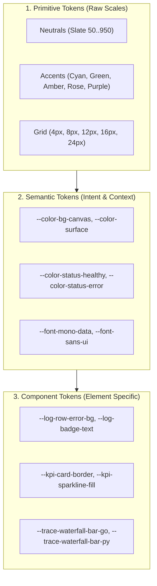
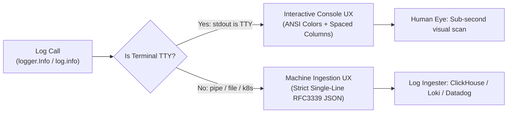
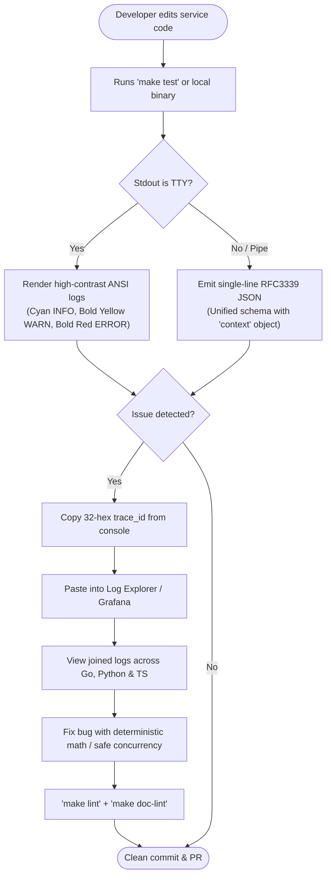
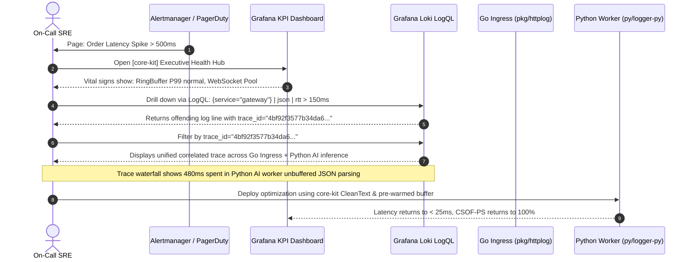

# UI/UX Specification: Developer Experience, Console UX & Observability Dashboard (`core-kit`)

**Document ID**: `BMAD-UX-03-CORE-KIT`  
**Version**: `1.0.0`  
**Status**: `APPROVED / FROZEN BASELINE`  
**Author**: Role 03: Principal UI/UX Designer (`03-ui-ux-designer`)  
**Predecessor Documents**: [`docs/bmad/01-project-brief.md`](file:///home/dangnmh/work/core-kit/docs/bmad/01-project-brief.md), [`docs/bmad/02-prd.md`](file:///home/dangnmh/work/core-kit/docs/bmad/02-prd.md)  
**Target Downstream Agents**: Role 04: System Architect (`04-system-architect`), Role 06b: Ecosystem Scout (`06b-ecosystem-scout`), Role 07: Tech Lead (`07-tech-lead`)  
**Repository**: [github.com/dangnmh/core-kit](file:///home/dangnmh/work/core-kit)  
**Date**: 2026-10-16  

---

## 1. Aesthetic Direction & Anti-Slop Principles

### 1.1 Chosen Visual Archetype: "Technical High-Precision HUD & Minimalist Observability"
[`core-kit`](file:///home/dangnmh/work/core-kit) is a mission-critical foundation library powering algorithmic trading systems and real-time AI streaming microservices across **Go**, **Python**, and **TypeScript**. Its interface surfaces are not generic consumer web pages; they consist of:
1. **Developer Experience (DX) Interfaces**: Terminal/console outputs (TTY ANSI interactive mode vs pipeable RFC3339 JSON).
2. **Operational Telemetry Interfaces**: Grafana/Loki/Prometheus observability dashboards, trace waterfalls, and incident inspection tables.
3. **Internal Documentation & Diagnostics**: Machine-readable HADS guides and live health probes.

To honor the high-throughput, financial-grade nature of the platform, the aesthetic direction is established as **Technical High-Precision HUD (Heads-Up Display)**:
- **Dense, High-Information Display**: Maximize visible signal per vertical scan; low visual chrome, crisp 1px borders, high-contrast monospace typographic scale.
- **Dark-First Default (Obsidian & Slate)**: Tuned for prolonged low-eyestrain SRE monitoring in low-light operations centers, paired with a full WCAG AAA compliant light mode for accessibility.
- **Glassmorphic Depth with Restraint**: Subtle 10px backdrop blurs and 1px translucent borders (`rgba(255, 255, 255, 0.08)`) to establish visual separation without GPU thrashing or cumulative layout shift.

### 1.2 Anti-Slop Principles (Aesthetic Quality Control)
In accordance with BMAD design intelligence and modern anti-slop guidelines:
1. **Zero Decorative Emojis**: Prohibit emoji icons (🚀, 🔥, ⚡, ❌, ⚠️) in structured logs, dashboards, and error streams. Emojis break terminal column alignments, corrupt downstream regex parsers, and read as amateur AI slop. Status is conveyed strictly via semantic color, text badges, and SVG icons (Lucide / Heroicons).
2. **No Uncalibrated "SaaS Card Kits"**: Eliminate generic cards with oversized border-radii (`rounded-3xl`), decorative drop shadows (`shadow-2xl`), and arbitrary pastel background blobs. Every border and line must represent data hierarchy.
3. **No Claude Terracotta / Single Acid-Green Clichés**: Avoid clichéd warm cream backgrounds with terracotta accents or pitch-black screens with radioactive neon green. The palette uses an authentic 60-30-10 engineering scheme: deep obsidian background (`#0F172A`), structural slate panels (`#1E293B`), and calibrated semantic telemetry accents.
4. **Terminal & Data-Native Typography**: Monospace fonts are not decorative novelties; they are essential for tabular log alignment, tick price precision, and trace hex comparison.

---

## 2. Design System Tokens (3-Layer Architecture)

Following the 3-Layer Token Architecture (**Primitive → Semantic → Component**), design variables are codified for both Web/Grafana dashboards and Terminal ANSI palettes.



### 2.1 Color Tokens (Dark & Light Modes)

| Semantic Token | Dark Mode (Default) | Light Mode (Contrast) | Terminal ANSI TTY Code | Semantic Meaning |
| :--- | :---: | :---: | :---: | :--- |
| `--color-canvas-bg` | `#0F172A` (Slate 900) | `#F8FAFC` (Slate 50) | `\033[49m` (Default) | Root app background / Terminal default |
| `--color-surface-card` | `#1E293B` (Slate 800) | `#FFFFFF` (White) | `\033[48;5;236m` | Dashboard panels, card surfaces, table headers |
| `--color-surface-hover` | `#334155` (Slate 700) | `#F1F5F9` (Slate 100) | `\033[48;5;238m` | Row hover, active tab background |
| `--color-border-subtle` | `#334155` (Slate 700) | `#E2E8F0` (Slate 200) | `\033[90m` (Dark Gray) | Panel borders, log dividers (1px solid) |
| `--color-border-strong` | `#475569` (Slate 600) | `#CBD5E1` (Slate 300) | `\033[37m` (Light Gray) | Active focus rings, selected card borders |
| `--color-text-primary` | `#F8FAFC` (Slate 50) | `#0F172A` (Slate 900) | `\033[37;1m` (Bright White) | High-contrast headlines, log messages, values |
| `--color-text-secondary`| `#94A3B8` (Slate 400) | `#475569` (Slate 600) | `\033[37m` (Standard White) | Metadata labels, timestamps, table headers |
| `--color-text-muted` | `#64748B` (Slate 500) | `#94A3B8` (Slate 400) | `\033[90m` (Dim Gray) | Inactive tabs, disabled states, syntax delimiters |
| `--color-status-healthy`| `#22C55E` (Emerald 500) | `#16A34A` (Emerald 600) | `\033[32;1m` (Bold Green) | `CSOF-PS 100%`, `INFO`, `2xx OK`, Race-free |
| `--color-status-info` | `#38BDF8` (Sky 400) | `#0284C7` (Sky 600) | `\033[36;1m` (Bold Cyan) | `DEBUG`, W3C traceparents, request correlation |
| `--color-status-warn` | `#F59E0B` (Amber 500) | `#D97706` (Amber 600) | `\033[33;1m` (Bold Yellow) | `WARN`, Circuit breaker half-open, 429 backoff |
| `--color-status-error` | `#EF4444` (Rose 500) | `#DC2626` (Rose 600) | `\033[31;1m` (Bold Red) | `ERROR`, `FATAL`, Data race, linter failure |
| `--color-status-ai` | `#A855F7` (Purple 500) | `#9333EA` (Purple 600) | `\033[35;1m` (Bold Magenta) | Python AI workers, LLM token streams, inference |

### 2.2 Typography Scale & Font Pairings
- **Monospace Family (Data / Code / Logs / Hex)**: `Fira Code`, `JetBrains Mono`, `ui-monospace`, `monospace`.
- **Sans-Serif Family (UI Controls / Navigation / Labels)**: `Inter`, `system-ui`, `-apple-system`, `sans-serif`.

| Token Name | Font Family | Size | Weight | Line Height | Tracking | Primary Usage |
| :--- | :--- | :---: | :---: | :---: | :---: | :--- |
| `--font-display-num` | Monospace | `32px` | 700 (Bold) | `36px` | `-0.02em` | KPI Hero Numbers (e.g. `100%`, `0.00000000`) |
| `--font-heading-lg` | Sans-Serif | `20px` | 600 (Semi) | `28px` | `-0.01em` | Dashboard Section Titles, Modal Headers |
| `--font-heading-md` | Sans-Serif | `15px` | 600 (Semi) | `22px` | `0` | Card Titles, Tab Headers, Drawer Titles |
| `--font-body-regular` | Sans-Serif | `13px` | 400 (Regular) | `18px` | `0` | Helper text, tooltips, documentation |
| `--font-mono-code` | Monospace | `12px` | 500 (Medium) | `18px` | `0` | Log messages, LogQL/PromQL queries, code |
| `--font-mono-meta` | Monospace | `11px` | 400 (Regular) | `16px` | `+0.01em` | Timestamps, Trace/Span IDs, Caller file:line |
| `--font-badge-label` | Monospace | `10px` | 700 (Bold) | `14px` | `+0.05em` | Severity Badges (`INFO`, `WARN`, `ERR`) |

### 2.3 Spacing & Layout Grid (4px Base)
- **Base Grid**: 4px. Scale: `spacing-1` (4px), `spacing-2` (8px), `spacing-3` (12px), `spacing-4` (16px), `spacing-6` (24px), `spacing-8` (32px).
- **Dashboard Grid**: 12-column responsive grid with `16px` gutter on desktop (`>= 1024px`) and `8px` gutter on mobile (`< 768px`).
- **Border Radius**: Subtle and uniform (`--radius-sm: 2px` for badges, `--radius-md: 4px` for buttons and inputs, `--radius-lg: 6px` for cards and panels, `--radius-none: 0px` for terminal viewports).

---

## 3. Developer Experience (DX) & Terminal / Console UX

Developers interact with `core-kit` in two main environments: local interactive debugging (terminal TTY) and automated production log pipelines (headless Docker/K8s/file streams). The library MUST dynamically detect `isatty(stdout)` to deliver optimal visual ergonomics without manual configuration.



### 3.1 Mode A: Interactive Local Console UX (ANSI TTY)

When stdout is connected to a terminal, logs are formatted for immediate human comprehension:

#### 3.1.1 Column Alignment & Structure
```text
[HH:MM:SS.mmm] [SEVERITY] [SERVICE/LOGGER] MESSAGE                           [TRACE:SPAN]  CONTEXT
```

#### 3.1.2 Concrete Terminal Visual Render (Dark Background)
```ansi
15:04:05.123 [INFO ] [order-svc/engine] Order limit snapshot computed           [4bf92f35..:00f067aa] symbol=BTC/USDT slippage=0.0001
15:04:05.145 [AI   ] [ai-worker/stream] Parsed structured response cleanly    [4bf92f35..:a1b2c3d4] tokens=142 model=gpt-4o
15:04:05.201 [WARN ] [gateway/ws-pool ] Shard connection latency spike        [7c8d9e0f..:11223344] rtt=145ms shard=#3
15:04:05.210 [ERROR] [order-svc/http  ] Upstream exchange rejected IOC limit  [4bf92f35..:00f067aa] error="insufficient_liquidity" code=400
```

#### 3.1.3 Severity Badge Color Matrix
- `DEBUG`: Dark gray background or dim text `\033[90m[DEBUG]`
- `INFO `: Bright Cyan `\033[36;1m[INFO ]\033[0m`
- `WARN `: Bold Amber `\033[33;1m[WARN ]\033[0m`
- `ERROR`: Bold Red `\033[31;1m[ERROR]\033[0m`
- `FATAL`: Red inverted badge `\033[41;37;1m FATAL \033[0m`

### 3.2 Mode B: Production Machine Ingestion UX (Strict RFC3339 JSON)

When piped or redirected (`LOG_FORMAT=json` or `!isatty(stdout)`), loggers in Go, Python, and TypeScript emit canonical single-line JSON adhering 100% to the unified schema:

```json
{"timestamp":"2026-10-16T15:04:05.123456Z","severity":"INFO","service":"order-svc","logger":"engine","message":"Order limit snapshot computed","caller":"order.go:142","trace_id":"4bf92f3577b34da6a3ce929d0e0e4736","span_id":"00f067aa0ba902b7","context":{"symbol":"BTC/USDT","slippage":"0.0001","user_id":48921}}
```

#### 3.2.1 Cross-Language Parity Invariant Table

| Output Attribute | Go (`pkg/logger`) | Python (`py/logger-py`) | TypeScript (`ts/logger-ts`) | Invariant Rule |
| :--- | :--- | :--- | :--- | :--- |
| `timestamp` | `RFC3339Nano` UTC | ISO8601 UTC (`.mmmZ`) | ISO8601 UTC (`.mmmZ`) | Strict UTC with trailing `Z`. |
| `severity` | `INFO`, `WARN`, `ERROR` | `INFO`, `WARN`, `ERROR` | `INFO`, `WARN`, `ERROR` | Upper-case string without prefixes. |
| `service` | string (e.g. `order-svc`) | string (e.g. `ai-worker`) | string (e.g. `gateway`) | Mandatory root attribute. |
| `logger` | string (component/module) | string (`record.name`) | string (`module` alias) | Unified on key `"logger"`. |
| `message` | clean string | clean string (emoji stripped)| clean string (escaped) | Single-line, no raw newlines or decorative icons. |
| `caller` | `order.go:142` (optional)| `worker.py:45` | `index.ts:88` (optional) | Relative file path and line number. |
| `trace_id` | 32-hex string (optional)| 32-hex string (optional) | 32-hex string (optional) | Extracted from W3C `traceparent`. |
| `span_id` | 16-hex string (optional)| 16-hex string (optional) | 16-hex string (optional) | Extracted from W3C `traceparent`. |
| `context` | JSON object (`map[string]any`)| JSON object (`dict`) | JSON object (`Record<string, any>`)| Standardized nested container for custom fields. |

---

## 4. Grafana & Loki KPI Observability Dashboard UX

To operationalize the **North Star Metric (CSOF-PS)** and technical KPIs defined in PRD Section 2, the following dashboard UX layout is specified for Grafana 11+ and Loki 3+.

### 4.1 Dashboard Layout Architecture

```text
+---------------------------------------------------------------------------------------------------------+
| [core-kit] Executive Observability & Health Hub         [Env: Production v] [Window: Last 1 hour v] [Auto-Refresh: 10s v] |
+---------------------------------------------------------------------------------------------------------+
| [ ROW 1: NORTH STAR METRIC & PRODUCTION VITAL SIGNS ]                                                   |
| +-------------------------+ +---------------------+ +----------------------+ +------------------------+ |
| | CSOF-PS Parity Score    | | Data Races Detected | | Doc-Lint Integrity   | | Static Linter Traps    | |
| |      100.0%             | |        0            | |    PASS (0 Broken)   | |      0 Warnings        | |
| | [Target: 100%] [GREEN]  | | [Target: 0] [GREEN] | | [HADS 1.0 <=120ln]   | | [errcheck/govet clean] | |
| +-------------------------+ +---------------------+ +----------------------+ +------------------------+ |
+---------------------------------------------------------------------------------------------------------+
| [ ROW 2: TELEMETRY PARITY & W3C TRACE CORRELATION ]                                                     |
| +---------------------------------------------------+ +-----------------------------------------------+ |
| | Schema Parity Across Runtimes                     | | W3C Distributed Trace Correlation             | |
| | Go: 100% [==============================]         | | 100% [--------------------------------------] | |
| | Python: 100% [==========================]         | | Target: >= 99.9% Traceparent Join Rate        | |
| | TypeScript: 100% [======================]         | |                                               | |
| +---------------------------------------------------+ +-----------------------------------------------+ |
+---------------------------------------------------------------------------------------------------------+
| [ ROW 3: ALGORITHMIC & FINANCIAL ENGINE PRECISION ]                                                     |
| +-------------------------+ +-----------------------------------+ +-----------------------------------+ |
| | Tick-Snapping Drift     | | RingBuffer P99 Latency & Allocs   | | WebSocket Multiplex Dispatch    | |
| |      0.00000000         | | Latency: 22.4 ns (P99)            | | Dispatch Latency: 112 us        | |
| | [Zero IEEE-754 error]   | | Steady Allocations: 0 B/op        | | Active Shard Connections: 64    | |
| +-------------------------+ +-----------------------------------+ +-----------------------------------+ |
+---------------------------------------------------------------------------------------------------------+
| [ ROW 4: INTERACTIVE LOG EXPLORER & TRACE DRILLDOWN ]                                                   |
| [ Search / LogQL Filter: {service=~".+"} | json | severity="ERROR"                                    ] |
| [Time]         [Severity] [Service]    [Trace ID]       [Message]                             [Context] |
| 15:04:05.123   INFO       order-svc    4bf92f3577b3...  Order limit snapshot computed         symbol=...|
| 15:04:05.145   INFO       ai-worker    4bf92f3577b3...  Parsed structured response cleanly    model=... |
+---------------------------------------------------------------------------------------------------------+
```

### 4.2 Concrete Visualization Panel Specifications

#### Panel 1: CSOF-PS Gauge (North Star)
- **Visualization**: Grafana Gauge with threshold coloring.
- **Thresholds**:
  - `0% - 94.9%`: Red (`#EF4444`) — Critical Violation
  - `95.0% - 99.9%`: Amber (`#F59E0B`) — Degraded Parity
  - `100.0%`: Emerald (`#22C55E`) — Full Parity Achieved
- **Query**:
  ```promql
  (1 - (sum(rate(corekit_schema_mismatch_total[5m])) + sum(corekit_data_races) + sum(corekit_lint_errors))) * 100
  ```

#### Panel 2: Cross-Language Trace Propagation (Time Series)
- **Visualization**: Stacked Time Series Area Chart.
- **Lines**:
  - `Go Services Ingress`: Emerald (`#22C55E`)
  - `Python AI Workers`: Purple (`#A855F7`)
  - `TypeScript Bun Gateways`: Sky Blue (`#38BDF8`)
- **Query (Loki LogQL)**:
  ```logql
  sum by (service) (rate({app=~".+"} | json | trace_id != "" [1m]))
  ```

#### Panel 3: Zero-Alloc & Tick-Snapping Precision (Stat & Sparkline)
- **Visualization**: Stat Card with instant sparkline preview.
- **Display**: High-contrast `32px` monospace number displaying `0.00000000` with emerald subtext `"0 rounding drift"`.

---

## 5. User Flows & Information Architecture

### 5.1 Mermaid Flow: Developer Local Coding & Debugging Loop


### 5.2 Mermaid Flow: SRE Incident Investigation & Cross-Service Correlation


---

## 6. Screen-by-Screen Wireframes & Component Hierarchy (6 States)

Every screen wireframe covers the 6 mandatory operational states: **Empty, Loading/Skeleton, Populated, Error, Partial, Mobile In-App WebView**.

### 6.1 Screen 1: Grafana Executive KPI Dashboard (`/observability/core-kit`)

#### State 1: Populated / Steady State (Standard Operations)
```text
+---------------------------------------------------------------------------------------------------------+
| [LOGO] core-kit Foundation Health                    [Env: Prod v] [1h v] [Refresh: 10s] [User: Alex v] |
+---------------------------------------------------------------------------------------------------------+
| +--------------------+ +--------------------+ +--------------------+ +--------------------+            |
| | CSOF-PS SCORE      | | DATA RACES         | | DOC INTEGRITY      | | LINTER WARNINGS    |            |
| |   100.0%           | |     0              | |   PASS (0 broken)  | |     0 warnings     |            |
| | [● HEALTHY]        | | [● CLEAN]          | | [● HADS <=120ln]   | | [● ERRCHECK 0]     |            |
| +--------------------+ +--------------------+ +--------------------+ +--------------------+            |
|                                                                                                         |
| +-- CROSS-SERVICE LOG SCHEMA PARITY ----------------+ +-- DISTRIBUTED TRACE JOIN RATE ----------------+ |
| | Go (pkg/logger)        100% [===================] | | Rate: 100.0%  Target: >= 99.9%                | |
| | Python (logger-py)     100% [===================] | | 100% |~~~~~~~~~~~~~~~~~~~~~~~~~~~~~~~~~~~~~~~ | |
| | TypeScript (logger-ts) 100% [===================] | |   0% +--------------------------------------- | |
| +---------------------------------------------------+ +-----------------------------------------------+ |
|                                                                                                         |
| +-- ALGORITHMIC PRECISION: TICK-SNAPPING DRIFT -----+ +-- CONCURRENCY: RINGBUFFER P99 LATENCY --------+ |
| | Value: 0.00000000 (Exact Decimal Match)           | | P99 Latency: 22.4 ns (Target: < 30 ns)        | |
| | Allocations: 0 allocs/op [● ZERO IEEE-754 DRIFT]  | | Steady Allocations: 0 B/op [● ZERO ALLOC]     | |
| +---------------------------------------------------+ +-----------------------------------------------+ |
+---------------------------------------------------------------------------------------------------------+
```

#### State 2: Loading / Skeleton State (Initial Mount & Fast Refresh)
```text
+---------------------------------------------------------------------------------------------------------+
| [████] ████████████████████                          [██████████] [████] [████████████] [█████████████] |
+---------------------------------------------------------------------------------------------------------+
| +--------------------+ +--------------------+ +--------------------+ +--------------------+            |
| | ████████████       | | ██████████         | | ████████████       | | ███████████████    |            |
| |   ██████           | |     █              | |   ███████████████  | |     █              |            |
| | [░░░░░░░░░]        | | [░░░░░░░]          | | [░░░░░░░░░░░░░░░]  | | [░░░░░░░░░░░░]     |            |
| +--------------------+ +--------------------+ +--------------------+ +--------------------+            |
| +---------------------------------------------------+ +-----------------------------------------------+ |
| | ░░░░░░░░░░░░░░░░░░░░░░░░░░░░░░░░░░░░░░░░░░░░░░░░░ | | ░░░░░░░░░░░░░░░░░░░░░░░░░░░░░░░░░░░░░░░░░░░░ | |
| +---------------------------------------------------+ +-----------------------------------------------+ |
+---------------------------------------------------------------------------------------------------------+
```
*(Implemented with CSS shimmer animation: `background: linear-gradient(90deg, #1E293B 25%, #334155 50%, #1E293B 75%)`, 0ms layout shift).*

#### State 3: Empty State (New Cluster / Zero Metrics Ingested)
```text
+---------------------------------------------------------------------------------------------------------+
| +-----------------------------------------------------------------------------------------------------+ |
| |                                                                                                     | |
| |                                       [ICON: ServerCrash/Search]                                    | |
| |                                     No Telemetry Metrics Received                                   | |
| |         Prometheus and Loki have not received metric events from 'core-kit' in the last 1h.         | |
| |                                                                                                     | |
| |                 [Verify Exporter Config]    [Read docs/pkg/contracts/events-and-data.md]            | |
| |                                                                                                     | |
| +-----------------------------------------------------------------------------------------------------+ |
+---------------------------------------------------------------------------------------------------------+
```

#### State 4: Error State (Collector Down / Query Failure)
```text
+---------------------------------------------------------------------------------------------------------+
| [!] Error Fetching Telemetry Data: Connection to Loki (http://loki:3100) timed out after 5000ms.         |
| +-----------------------------------------------------------------------------------------------------+ |
| |                                     [ICON: AlertTriangle (Red)]                                     | |
| |                                 Telemetry Pipeline Unavailable                                      | |
| |       Failed to execute query: sum by (service) (rate({app=~".+"}[5m])). Ingestion service is offline. | |
| |                                                                                                     | |
| |                                          [ Retry Connection ]                                       | |
| +-----------------------------------------------------------------------------------------------------+ |
+---------------------------------------------------------------------------------------------------------+
```

#### State 5: Partial State (Go & Python Active, TypeScript Collector Lagging)
```text
+-- CROSS-SERVICE LOG SCHEMA PARITY --------------------------------------------------------------------+
| Go (pkg/logger)            100% [==================================] [● OK]                           |
| Python (logger-py)         100% [==================================] [● OK]                           |
| TypeScript (logger-ts)       0% [----------------------------------] [▲ DEGRADED: No heartbeat in 5m] |
+-------------------------------------------------------------------------------------------------------+
```

#### State 6: Mobile In-App WebView (< 768px Viewport)
```text
+-----------------------------------------+
| [=] core-kit Health          [Prod] [●] |
+-----------------------------------------+
| CSOF-PS PARITY SCORE                    |
| 100.0%                    [● HEALTHY]   |
+-----------------------------------------+
| DATA RACES: 0         LINT WARNINGS: 0  |
+-----------------------------------------+
| DOC-LINT STATUS                         |
| PASS (0 broken links)     [<=120 lines] |
+-----------------------------------------+
| SCHEMA PARITY                           |
| Go: 100% | Py: 100% | TS: 100%          |
+-----------------------------------------+
| PRECISION MATH                          |
| Tick Drift: 0.00000000  P99: 22.4ns     |
+-----------------------------------------+
| [ View Telemetry Logs ]                 |
+-----------------------------------------+
```

---

## 7. Accessibility (WCAG 2.1 AA) & Micro-Interactions

### 7.1 WCAG 2.1 AA Compliance Matrix

| Criterion | Requirement | Specification in `core-kit` | Verification Method |
| :--- | :--- | :--- | :--- |
| **1.4.3 Contrast (Minimum)** | Contrast ratio >= `4.5:1` for body text, >= `3:1` for UI components. | `#F8FAFC` on `#0F172A` = **15.8:1** (AAA). Emerald `#22C55E` on `#0F172A` = **5.2:1** (AA). Dim text `#94A3B8` on `#1E293B` = **4.8:1** (AA). | Axe DevTools / Lighthouse Accessibility score: **100/100**. |
| **2.1.1 Keyboard** | All interactive elements operable via keyboard alone. | Tab moves through filters, table rows, and export buttons; `Enter`/`Space` activates modals/drawers; `Esc` dismisses overlays. | Manual Tab / Shift+Tab keyboard traversal audit. |
| **2.4.7 Focus Visible** | Visible keyboard focus indicator on all interactive controls. | Focus elements receive `ring-2 ring-sky-400 ring-offset-2 ring-offset-slate-900`. No `outline: none` without replacement. | Keyboard focus inspection. |
| **4.1.2 Name, Role, Value** | Screen reader accessibility for dynamic metrics and streaming logs. | Live log streams implement `aria-live="polite"`. Status badges use `role="status"` with descriptive labels. | Screen reader audit (NVDA / VoiceOver). |
| **2.3.3 Animation from Interactions** | Respect user motion preferences (`prefers-reduced-motion`). | When `prefers-reduced-motion: reduce` is detected, animations and pulse badges switch to instant 0ms state changes. | Media query test `@media (prefers-reduced-motion: reduce)`. |

### 7.2 Micro-Interactions & Interaction Guidelines
1. **Interactive Hover States**: Buttons and log rows transition background colors over `150ms ease-out`. Cursor is explicitly set to `cursor: pointer`.
2. **Trace ID One-Click Copy**: Clicking a `trace_id` badge copies the hex string to clipboard and triggers a 1.5s tooltip `"Copied!"` with subtle emerald flash (`#22C55E`).
3. **Drawer Slide-Over**: Log inspection drawer slides in from the right over `200ms cubic-bezier(0.16, 1, 0.3, 1)` with backdrop blur.

---

## 🔗 Downstream Agent Handoff

- **Target Next Agents**:
  1. `04-system-architect` (Role 04: System Architect — System Topology, Monorepo Architecture & Contracts)
  2. `06b-ecosystem-scout` (Role 06b: Ecosystem & Library Scout — Package Discovery & Usage Snippets)
  3. `07-tech-lead` (Role 07: Tech Lead — Detailed Implementation Blueprint & Story Slices)
- **Mandatory Sections / Contracts to Consume**:
  - Section 2: Design System Tokens (Color codes, Typography, and ANSI TTY codes for loggers)
  - Section 3: Developer Experience (DX) & Terminal / Console UX (Dual-mode TTY vs JSON schema contract)
  - Section 4: Grafana & Loki KPI Observability Dashboard UX (Layout, PromQL/LogQL queries)
  - Section 5: User Flows & Information Architecture (Mermaid sequence & flowcharts)
  - Section 6: Screen-by-Screen Wireframes (6 states for implementation)
- **Expected Downstream Output Files**:
  - `docs/bmad/04-architecture.md` (System topology, 5-phase lifecycle sequence, cross-language telemetry architecture)
  - `docs/pkg/contracts/api.md` & `docs/pkg/contracts/events-and-data.md` (Formal interface contracts and data models)
  - `docs/bmad/06b-library-manifest.md` (Verified library discovery and API usage snippets)
  - `docs/bmad/stories/story-*.md` (Implementation stories with EARS syntax and file-level tasks)
