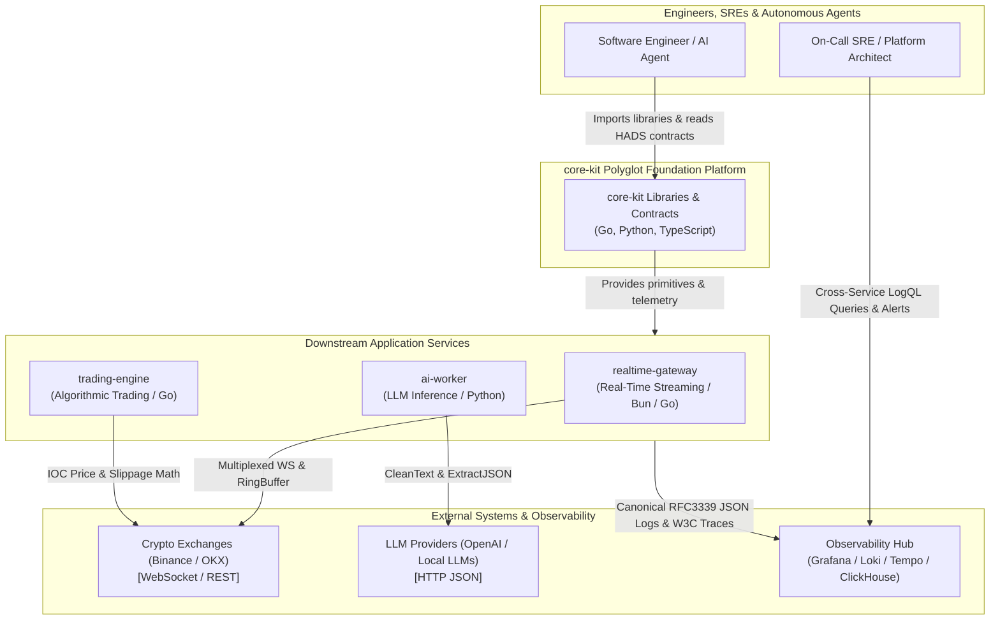
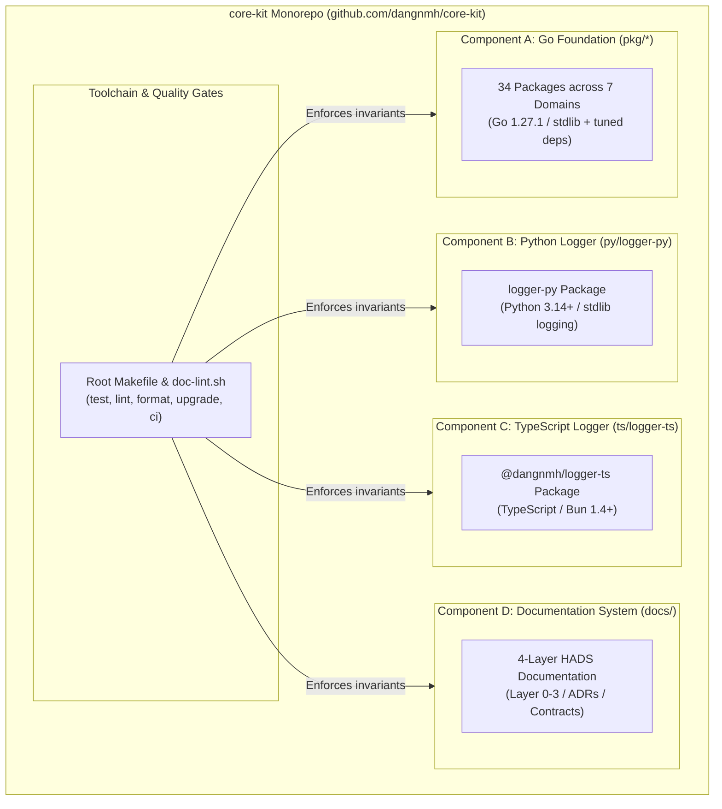
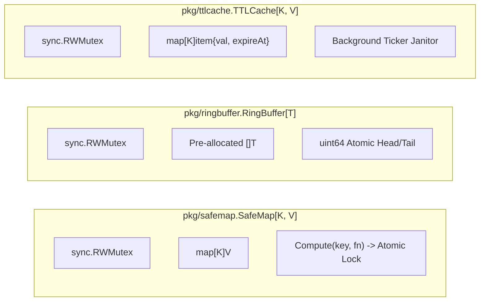

# System Architecture & Technical Specification: Polyglot Foundation Platform (`core-kit`)

**Document ID**: `BMAD-ARCH-04-CORE-KIT`  
**Version**: `1.0.0`  
**Status**: `APPROVED / BASELINE ARCHITECTURE`  
**Author**: Role 04: Principal System Architect (`04-system-architect`)  
**Predecessor Documents**: [`docs/bmad/01-project-brief.md`](file:///home/dangnmh/work/core-kit/docs/bmad/01-project-brief.md), [`docs/bmad/02-prd.md`](file:///home/dangnmh/work/core-kit/docs/bmad/02-prd.md), [`docs/bmad/03-ui-ux-spec.md`](file:///home/dangnmh/work/core-kit/docs/bmad/03-ui-ux-spec.md)  
**Target Next Agents**: Role 05: Senior DB Engineer (`05-senior-db-engineer`), Role 06: Security Engineer (`06-security-engineer`), Role 06b: Ecosystem Scout (`06b-ecosystem-scout`), Role 07: Tech Lead (`07-tech-lead`)  
**Repository**: [github.com/dangnmh/core-kit](file:///home/dangnmh/work/core-kit)  
**Date**: 2026-10-16  

---

## 1. Project Constitution (`CONST-01..CONST-08` Non-Negotiable Invariants)

Every downstream implementation story (`docs/bmad/stories/story-*.md`), sprint plan (`docs/<component>/tasks/sprint-*.md`), and Pull Request **MUST** satisfy the following 8 architectural invariants. Any code change violating these rules will be rejected at the Code Review Gate (`12-code-reviewer`):

- **`CONST-01` (Zero-Storage Foundation Invariant)**:
  `core-kit` is a stateless, pure-compute and in-memory foundation platform. It owns zero persistent databases, zero database tables, and zero disk-backed storage volumes. All data structures ([`SafeMap`](file:///home/dangnmh/work/core-kit/pkg/safemap), [`RingBuffer`](file:///home/dangnmh/work/core-kit/pkg/ringbuffer), [`TTLCache`](file:///home/dangnmh/work/core-kit/pkg/ttlcache), [`Quadtree`](file:///home/dangnmh/work/core-kit/pkg/quadtree)) operate in transient process memory. Downstream services persist state into their own database bounded contexts.
- **`CONST-02` (Strict Reuse-Over-Reinvent Invariant)**:
  Before implementing any utility, parsing, networking, or concurrency mechanism, engineers and agents MUST follow the 4-tier lookup hierarchy (Tier 1: internal shared `pkg/`, Tier 2: manifest dependencies, Tier 3: battle-tested community libraries, Tier 4: custom domain logic only). Hand-rolling custom string slicing, duplicate ID generators, or uncoordinated goroutines is strictly prohibited.
- **`CONST-03` (Unified Polyglot Telemetry Parity Invariant)**:
  Loggers across Go ([`pkg/logger`](file:///home/dangnmh/work/core-kit/pkg/logger)), Python ([`py/logger-py`](file:///home/dangnmh/work/core-kit/py/logger-py)), and TypeScript ([`ts/logger-ts`](file:///home/dangnmh/work/core-kit/ts/logger-ts)) MUST emit single-line RFC3339 JSON records conforming to the canonical schema (`timestamp`, `severity`, `service`, `logger`, `message`, `caller`, `trace_id`, `span_id`, `context`). LogQL / ClickHouse queries must match across all runtimes without language-specific translation.
- **`CONST-04` (Zero-Data-Race Concurrency Invariant)**:
  100% of concurrent data structures and background loops MUST pass Go race detection (`go test -race ./...`) with 0 data races detected under high-contention stress testing (10,000 ops across 50 concurrent workers).
- **`CONST-05` (Financial-Grade Math Precision Invariant)**:
  Under NO circumstances may raw IEEE-754 `float64` arithmetic be used for financial balances, tick price snapping, or exchange order sizing without explicit wrapping in [`pkg/decmath.Decimal`](file:///home/dangnmh/work/core-kit/pkg/decmath) or invocation of [`pkg/decmath.SnapToTickFloor`](file:///home/dangnmh/work/core-kit/pkg/decmath) / [`SnapToTickCeil`](file:///home/dangnmh/work/core-kit/pkg/decmath).
- **`CONST-06` (Fail-Fast Bootstrapping Invariant)**:
  Service configurations MUST be loaded and validated via [`pkg/bootstrap.MustLoad[T]`](file:///home/dangnmh/work/core-kit/pkg/bootstrap). Any missing required environment variables, malformed configuration files, or invalid structs MUST cause the binary to abort immediately (`exit(1)`) during startup before opening network sockets.
- **`CONST-07` (5-Phase Coordinated Graceful Shutdown Invariant)**:
  All long-running processes MUST integrate with [`pkg/lifecycle.Manager`](file:///home/dangnmh/work/core-kit/pkg/lifecycle) to ensure orderly termination across 5 sequential phases: `PreStop` $\rightarrow$ `StopIngress` $\rightarrow$ `Drain` $\rightarrow$ `StopEgress` $\rightarrow$ `PostStop`. No in-flight HTTP request or active order batch may be dropped during shutdown.
- **`CONST-08` (BMAD 4-Layer HADS Documentation Standard Invariant)**:
  Layer 0 (`AGENTS.md`) and all Layer 1 component guides (`docs/<comp>/README.md`) MUST NOT exceed `120 lines`. Unbuilt or future capabilities must be isolated in `docs/<comp>/backlog/`. The documentation suite must maintain 0 broken relative markdown links, verified by `make doc-lint`.

---

## 2. Executive Summary & Architecture Decision Records (ADRs)

### 2.1 Executive Summary
[`core-kit`](file:///home/dangnmh/work/core-kit) is a unified, polyglot software engineering platform providing zero-alloc concurrency primitives, financial-grade precision math, resilient networking, and standardized distributed observability across **Go 1.27+**, **Python 3.14+**, and **TypeScript/Bun 1.4+**.

The platform is organized into three runtime library components and one documentation system:
1. **Component A: Go Foundation (`pkg/*`)**: 34 packages organized into 7 functional domains.
2. **Component B: Python Logger (`py/logger-py/`)**: Zero-dependency structured JSON logger with emoji stripping and caller tracking.
3. **Component C: TypeScript Logger (`ts/logger-ts/`)**: Zero-dependency Bun/Node JSON logger with context inheritance and trace correlation.
4. **Component D: 4-Layer HADS Documentation Platform (`docs/`)**: Machine-readable context router, component guardrails, and frozen contracts.

### 2.2 Architecture Decision Records (ADRs)
The following ADRs establish binding decisions for the platform:

| ADR ID | Title | Status | Primary Decision & Architectural Impact | Link |
| :--- | :--- | :---: | :--- | :--- |
| **ADR-001** | Unified Polyglot Structured Logging Schema | **Accepted** | Standardizes canonical single-line RFC3339 JSON schema with `"logger"` and nested `"context"` container across Go, Python, and TypeScript, backed by Go dual-mode attribute mapping. | [ADR-001](file:///home/dangnmh/work/core-kit/docs/adr/ADR-001-unified-polyglot-logging.md) |
| **ADR-002** | Sharded Multiplexed WebSocket Pool & Dispatcher | **Accepted** | Implements connection sharding (`pkg/ws.Pool`) with topic-based routing, auto-reconnect backoff, and generic asynchronous RPC correlation (`RequestDispatcher[T]`) to bypass exchange limits. | [ADR-002](file:///home/dangnmh/work/core-kit/docs/adr/ADR-002-websocket-architecture.md) |
| **ADR-003** | Polyglot Linter, Formatter, and CI Toolchain | **Accepted** | Establishes ecosystem-native quality gates (`golangci-lint` v2 + `gofmt`, `ESLint` 9 + `Bun`, `Ruff` + `pytest`, `scripts/doc-lint.sh`) orchestrated via root `Makefile`. | [ADR-003](file:///home/dangnmh/work/core-kit/docs/adr/ADR-003-polyglot-linter-and-ci-toolchain.md) |

---

## 3. C4 Architecture Diagrams (System Context, Container & Components)

### 3.1 C4 Level 1: System Context Diagram



### 3.2 C4 Level 2: Container Diagram (Repository Layout)



### 3.3 C4 Level 3: Component Diagram (Go 7 Functional Domains)

```mermaid
flowchart TB
    subgraph GoPackages["Go Core Foundation Topology (pkg/*)"]
        subgraph D1["Domain 1: Core & Lifecycle"]
            bootstrap["bootstrap\n(MustLoad)"]
            config["config\n(YAML/JSONC/Env)"]
            lifecycle["lifecycle\n(5-Phase Manager)"]
            version["version\n(ldflags metadata)"]
        end

        subgraph D2["Domain 2: Telemetry & Observability"]
            logger["logger\n(slog / TraceHandler)"]
            httplog["httplog\n(PII Sanitizer)"]
            tracer["tracer\n(OTel W3C)"]
            tracectx["tracectx\n(Request ID)"]
        end

        subgraph D3["Domain 3: Networking & Resilience"]
            httpclient["httpclient\n(Pool / Retry / OTel)"]
            httpserver["httpserver\n(Gin Engine / Probes)"]
            ws["ws\n(Sharded Pool / RPC)"]
            wsclient["wsclient\n(Auto-Reconnect)"]
            wsserver["wsserver\n(Broadcast)"]
            ratelimit["ratelimit\n(Weighted Limiter)"]
            resilience["resilience\n(CircuitBreaker / Backoff)"]
            ticker["ticker\n(Jitter Runner)"]
            eventbus["eventbus\n(Watermill PubSub)"]
        end

        subgraph D4["Domain 4: Data Structures & Algorithms"]
            ringbuffer["ringbuffer\n(Zero-Alloc Ring)"]
            safemap["safemap\n(Atomic Compute)"]
            ttlcache["ttlcache\n(Janitor Cache)"]
            priorityqueue["priorityqueue\n(Heap)"]
            quadtree["quadtree\n(2D Spatial Index)"]
        end

        subgraph D5["Domain 5: Financial Precision & Math"]
            decmath["decmath\n(Tick-Snapping / Decimal)"]
            tradecalc["tradecalc\n(IOC Slippage / Wall)"]
        end

        subgraph D6["Domain 6: Types & Serialization"]
            idgen["idgen\n(Authoritative NanoID)"]
            idutil["idutil\n(Deprecated Alias)"]
            jsonutil["jsonutil\n(Unmarshal[T])"]
            xjson["xjson\n(Number/FlexTime)"]
            types["types\n(JSON Duration)"]
            ptr["ptr\n(To/Value/Equal)"]
            strutil["strutil\n(TruncateRunes)"]
            maputil["maputil\n(Panic-free Map)"]
            formatutil["formatutil\n(USD / Commas)"]
        end

        subgraph D7["Domain 7: AI & LLM Integration"]
            llm["llm\n(CleanText / ExtractJSON)"]
        end
    end

    bootstrap --> config
    httpserver --> lifecycle
    httpclient --> tracer
    httpclient --> resilience
    ws --> safemap
    tradecalc --> decmath
    idutil --> idgen
    llm --> strutil
    llm --> jsonutil
```



---

## 4. Reuse-Over-Reinvent & Capability Identification Matrix

Following the **Library-First Engineering Policy** (`reuse-over-reinvent`), every capability is audited and mapped to its authoritative lookup tier. Non-domain plumbing is flagged for verification by `06b-ecosystem-scout` in `docs/bmad/06b-library-manifest.md`.

| Functional Domain | Specific Capability | Lookup Tier | Recommended Library / Source Package | Verification Action for `06b-ecosystem-scout` |
| :--- | :--- | :---: | :--- | :--- |
| **Numeric Precision** | Financial Decimal Arithmetic | **Tier 2** | `github.com/shopspring/decimal` (v1.4.0) | Verify decimal precision, rounding modes, zero allocation performance. |
| **Networking** | High-Throughput WebSockets | **Tier 2** | `github.com/gorilla/websocket` (v1.5.3) | Verify ping/pong keepalive, read/write concurrency safety, buffer tuning. |
| **Configuration** | Strict Struct Validation | **Tier 2** | `github.com/go-playground/validator/v10` (v10.30.5) | Verify struct tag rules (`required`, `gte`, `lte`) in `pkg/config`. |
| **Resilience** | Full-Jitter Exponential Backoff | **Tier 2** | `github.com/cenkalti/backoff/v4` (v4.3.0) | Verify jitter formula and maximum retry intervals in `pkg/resilience`. |
| **Resilience** | Distributed Circuit Breaker | **Tier 2** | `github.com/sony/gobreaker/v2` (v2.1.0) | Verify state transitions (`Closed` $\rightarrow$ `Open` $\rightarrow$ `HalfOpen`). |
| **Lifecycle** | Multi-Phase Dependency Injection | **Tier 2** | `go.uber.org/fx` (v1.24.0) | Verify shutdown hooks and lifecycle coordination in `pkg/lifecycle`. |
| **Telemetry** | W3C Distributed Tracing | **Tier 2** | `go.opentelemetry.io/otel` (v1.47.0) | Verify W3C traceparent header format (`00-<trace_id>-<span_id>-<flags>`). |
| **Serialization** | Resilient JSON with Comments | **Tier 2** | `github.com/tailscale/hujson` | Verify JSONC stripping in `pkg/config/jsonc.go`. |
| **HTTP Routing** | Low-Latency HTTP Engine | **Tier 2** | `github.com/gin-gonic/gin` (v1.12.0) | Verify middleware chain, `/healthz`, `/readyz`, CORS headers. |
| **String Utilities** | Unicode Rune Truncation | **Tier 1** | `pkg/strutil.TruncateRunes` | Refactor `pkg/llm` to consume `pkg/strutil` (AUDIT-04 / Story 3.2). |
| **ID Generation** | Cryptographic NanoID | **Tier 1** | `pkg/idgen.NanoID` | Deprecate duplicate `pkg/idutil` and alias to `pkg/idgen` (AUDIT-03 / Story 3.1). |
| **Python Tooling** | Fast Linting & Formatting | **Tier 3** | `ruff` (>= 0.8.0 via `uv`) | Configure `[tool.ruff]` in `py/logger-py/pyproject.toml`. |
| **TypeScript Tooling**| Zero-Dependency Runtime | **Tier 3** | `bun test` + `eslint` 9 (Flat Config) | Configure `ts/logger-ts/eslint.config.mjs` and isolated test stream. |
| **Doc Governance** | HADS Markdown Linter | **Tier 4** | `scripts/doc-lint.sh` | Custom bash validator checking line caps (`<= 120`) and link validity. |

---

## 5. Interface Contracts & Polyglot Schema Specifications

### 5.1 Canonical Cross-Language JSON Log Schema (RFC3339)

All telemetry emitted by Go, Python, and TypeScript services MUST conform to this single-line JSON format:

```json
{
  "timestamp": "2026-10-16T15:04:05.123456Z",
  "severity": "INFO",
  "service": "order-svc",
  "logger": "engine",
  "message": "Order limit snapshot computed",
  "caller": "order.go:142",
  "trace_id": "4bf92f3577b34da6a3ce929d0e0e4736",
  "span_id": "00f067aa0ba902b7",
  "context": {
    "symbol": "BTC/USDT",
    "slippage": "0.0001",
    "user_id": 48921
  }
}
```

#### Field Specifications & Types

| Field Name | Type | Presence | Language Rules |
| :--- | :--- | :---: | :--- |
| `timestamp` | `string` | **Mandatory** | RFC3339 UTC with nanosecond or millisecond precision and trailing `Z`. |
| `severity` | `string` | **Mandatory** | Canonical values: `DEBUG`, `INFO`, `WARN`, `ERROR`, `FATAL`. |
| `service` | `string` | **Mandatory** | Logical service identifier provided at initialization. |
| `logger` | `string` | **Mandatory** | Emitting subsystem/module name. In Go, aliased to `"module"` for legacy compatibility. |
| `message` | `string` | **Mandatory** | Clean message string. All Unicode emojis and decorative icons stripped. |
| `caller` | `string` | *Optional* | Source code location formatted as `filename:lineno`. |
| `trace_id` | `string` | *Optional* | 32-hex character W3C distributed trace ID. |
| `span_id` | `string` | *Optional* | 16-hex character W3C distributed span ID. |
| `context` | `object` | *Optional* | Nested JSON object containing custom domain attributes. |

### 5.2 Go Dual-Mode Attribute Mapping Contract (`pkg/logger`)

To bridge existing Go loggers with the canonical schema:
1. **Canonical Mode (Default)**: Any custom attribute passed via `logger.Info("msg", "key", val)` is placed inside the `"context"` object.
2. **Legacy Flattening Mode**: If configured via `LOG_LEGACY_FLAT=true` or programmatically, attributes are mirrored at both the root and within `"context"`, preventing downstream ingestion breakage during migrations.

### 5.3 Asynchronous WebSocket RPC Protocol (`pkg/ws.RequestDispatcher[T]`)

For asynchronous request-response protocols over WebSockets:
- **Request Frame**:
  ```json
  {"id": "req-01h8z...", "method": "order.create", "params": {"symbol": "BTC/USDT", "amount": "0.5"}}
  ```
- **Response Frame**:
  ```json
  {"id": "req-01h8z...", "result": {"order_id": "ord-9921", "status": "FILLED"}, "error": null}
  ```
- **Idempotency Rule**: Every request MUST include a unique NanoID (`req_id`). The dispatcher correlates responses using thread-safe channels (`SafeMap[string, chan *T]`) with a hard timeout context. Unmatched frames are routed to standard topic handlers.

---

## 6. Per-Component Directory Structure & Module Ownership Map

```text
core-kit/
├── .golangci.yml            # Go linter configuration (version 2)
├── Makefile                 # Unified test, lint, format, upgrade & ci runner
├── README.md                # Layer 0 Root README
├── AGENTS.md                # Layer 0 Constitution & AI Context Router (<= 120 lines)
├── llms.txt                 # Layer 0 AI Sitemap to all docs
├── scripts/
│   └── doc-lint.sh          # Automated HADS documentation validator
├── pkg/                     # Component A: Go Foundation (34 Packages)
│   ├── bootstrap/           # Domain 1: Fail-fast config loader
│   ├── config/              # Domain 1: YAML/JSONC loader & validator
│   ├── lifecycle/           # Domain 1: 5-phase graceful shutdown
│   ├── version/             # Domain 1: ldflags build metadata
│   ├── logger/              # Domain 2: slog JSON logger + dual-mode context
│   ├── httplog/             # Domain 2: PII sanitizing HTTP middleware
│   ├── tracer/              # Domain 2: OpenTelemetry W3C exporter
│   ├── tracectx/            # Domain 2: Request ID context correlation
│   ├── httpclient/          # Domain 3: Resilient HTTP pool
│   ├── httpserver/          # Domain 3: Production Gin engine
│   ├── ws/                  # Domain 3: Sharded multiplexed WS pool
│   ├── wsclient/            # Domain 3: Auto-reconnecting WS client
│   ├── wsserver/            # Domain 3: WebSocket broadcast server
│   ├── ratelimit/           # Domain 3: Weighted rate limiter
│   ├── resilience/          # Domain 3: Circuit breaker & backoff
│   ├── ticker/              # Domain 3: Periodic jitter runner
│   ├── eventbus/            # Domain 3: Watermill pub/sub bus
│   ├── ringbuffer/          # Domain 4: Zero-alloc circular buffer
│   ├── safemap/             # Domain 4: Thread-safe map with Compute
│   ├── ttlcache/            # Domain 4: Memory cache with janitor
│   ├── priorityqueue/       # Domain 4: Generic Min/Max heap
│   ├── quadtree/            # Domain 4: 2D spatial indexing quadtree
│   ├── decmath/             # Domain 5: Financial decimal & tick snapping
│   ├── tradecalc/           # Domain 5: Slippage & IOC calculators
│   ├── idgen/               # Domain 6: Authoritative NanoID generator
│   ├── idutil/              # Domain 6: Deprecated alias to idgen
│   ├── jsonutil/            # Domain 6: Generic unmarshal helpers
│   ├── xjson/               # Domain 6: Resilient number & flex time
│   ├── types/               # Domain 6: JSON duration unmarshaler
│   ├── ptr/                 # Domain 6: Pointer helpers (To/Value/Equal)
│   ├── strutil/             # Domain 6: UTF-8 rune truncation
│   ├── maputil/             # Domain 6: Panic-free map accessors
│   ├── formatutil/          # Domain 6: Currency & number formatters
│   └── llm/                 # Domain 7: CleanText & ExtractJSON
├── py/logger-py/            # Component B: Python Structured Logger
│   ├── pyproject.toml       # Python project metadata & Ruff config
│   ├── README.md            # Local component guide
│   ├── logger_py/           # Source: Formatter, setup_logging, get_logger
│   └── tests/               # Pytest suite
├── ts/logger-ts/            # Component C: TypeScript Structured Logger
│   ├── package.json         # Bun / Node package definition
│   ├── eslint.config.mjs    # ESLint 9 Flat Config
│   ├── README.md            # Local component guide
│   ├── src/                 # Source: types.ts, index.ts
│   └── tests/               # Bun test suite
└── docs/                    # Component D: 4-Layer HADS Documentation
    ├── adr/                 # Layer 2: ADR-001, ADR-002, ADR-003
    ├── bmad/                # Layer 2: 01-brief, 02-prd, 03-ui-ux, 04-architecture
    ├── pkg/                 # Layer 1: README.md, contracts/api.md, backlog/
    ├── py/                  # Layer 1: README.md, contracts/api.md, backlog/
    └── ts/                  # Layer 1: README.md, contracts/api.md, backlog/
```

---

## 7. Concurrency, Resilience & Failure Modes

### 7.1 Concurrency Architecture & Memory Models

All shared state structures in `core-kit` employ explicit synchronization primitives:



- **`SafeMap`**: Read-heavy paths acquire `RLock()`. State mutation or compute calls (`Compute`, `GetOrSet`) acquire exclusive write `Lock()`, guaranteeing atomicity without race conditions.
- **`RingBuffer`**: Pre-allocates memory for `capacity` items during construction. Push operations overwrite oldest elements in constant time ($O(1)$) with `0 allocs/op`.
- **`TTLCache`**: Read calls check expiration timestamps. A background goroutine spawned via `pkg/ticker` scrubs expired entries at a configurable cleanup interval.

### 7.2 5-Phase Graceful Shutdown State Machine (`pkg/lifecycle`)

To guarantee zero data loss during service deployment or pod termination:

```mermaid
stateDiagram-v2
    [*] --> Phase1_PreStop: SIGTERM / SIGINT Received
    note right of Phase1_PreStop: Phase 1: Notify orchestrator\nLog shutdown event
    Phase1_PreStop --> Phase2_StopIngress: PreStop hooks complete
    note right of Phase2_StopIngress: Phase 2: Set /readyz -> 503\nStop accepting new external traffic
    Phase2_StopIngress --> Phase3_Drain: Ingress endpoints closed
    note right of Phase3_Drain: Phase 3: Wait for in-flight requests\nDrain consumer batches (up to 15s)
    Phase3_Drain --> Phase4_StopEgress: In-flight work drained
    note right of Phase4_StopEgress: Phase 4: Close WebSocket pools\nClose DB connection pools & queues
    Phase4_StopEgress --> Phase5_PostStop: Egress connections closed
    note right of Phase5_PostStop: Phase 5: Flush file loggers\nClean temporary files
    Phase5_PostStop --> [*]: Clean Process Exit (0)
```

### 7.3 Resilience, Timeouts & Circuit Breaking Policies

| Failure Mode | Detection Signal | Mitigation Strategy | Component Responsible |
| :--- | :--- | :--- | :--- |
| **Upstream 429 Rate Limit** | HTTP 429 / WS error code 429 | Full-jitter exponential backoff with retry pause (`pkg/resilience.Backoff`). | `pkg/httpclient`, `pkg/resilience` |
| **Repeated 5xx Server Outage** | 5 consecutive request failures | Circuit breaker transitions to `StateOpen`, failing fast for 5 seconds before testing `StateHalfOpen`. | `pkg/resilience.Breaker` |
| **WebSocket Connection Drop** | Gorilla read error / EOF | Shard automatically reconnects using jittered backoff; active subscriptions re-sent immediately. | `pkg/ws.Pool`, `pkg/wsclient` |
| **Slow Log Destination** | Writable pipe blocking | Asynchronous flush with bounded buffer; drop on buffer overflow rather than blocking trading hot path. | `pkg/logger`, `ts/logger-ts` |
| **Missing Config Key** | Struct validation failure | Immediate `panic` or `os.Exit(1)` during startup with explicit field name error. | `pkg/bootstrap`, `pkg/config` |

---

## 🔗 Downstream Agent Handoff

- **Target Next Agents**:
  1. `05-senior-db-engineer` (Role 05: Senior Database Engineer — Dual-Mode & Zero-Storage Review)
  2. `06-security-engineer` (Role 06: Security Engineer — Threat Model, PII Sanitization & Secret Hygiene)
  3. `06b-ecosystem-scout` (Role 06b: Ecosystem & Library Scout — Package Verification & Library Manifest)
  4. `07-tech-lead` (Role 07: Tech Lead & Scrum Master — Byte-Level Implementation Stories & Sprint Plan)
- **Mandatory Sections / Contracts to Consume**:
  - Section 1: Project Constitution (`CONST-01` through `CONST-08`)
  - Section 2: Executive Summary & Architecture Decision Records (`ADR-001`, `ADR-002`, `ADR-003`)
  - Section 3: C4 Container & Component Diagrams
  - Section 4: Reuse-Over-Reinvent Matrix (Scout package radar targets)
  - Section 5: Canonical Log JSON Schema & Asynchronous WebSocket RPC Protocol
  - Section 6: Per-Component Directory Structure & Module Ownership Map
  - Section 7: Concurrency Models & 5-Phase Graceful Shutdown State Machine
  - Frozen Contracts: [`docs/pkg/contracts/api.md`](file:///home/dangnmh/work/core-kit/docs/pkg/contracts/api.md), [`docs/py/contracts/api.md`](file:///home/dangnmh/work/core-kit/docs/py/contracts/api.md), [`docs/ts/contracts/api.md`](file:///home/dangnmh/work/core-kit/docs/ts/contracts/api.md)
- **Expected Downstream Output Files**:
  - `docs/bmad/05-database-spec.md` (Senior DB Engineer: Zero-Storage Invariant Certification & In-Memory Data Models)
  - `docs/bmad/06-security-spec.md` (Security Engineer: STRIDE Threat Model & PII/Secret Sanitization Rules)
  - `docs/bmad/06b-library-manifest.md` (Ecosystem Scout: Verified Community Library Manifest with API Snippets)
  - `docs/bmad/stories/story-*.md` (Tech Lead: Concrete Implementation Stories with AWS Kiro EARS & TDD Plans)
