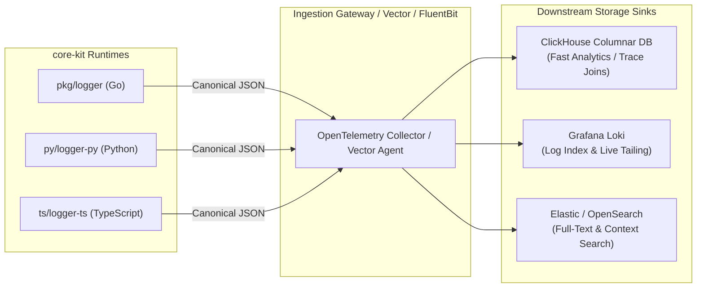

# Data Architecture, In-Memory State Models & Telemetry Storage Specification (`core-kit`)

**Document ID**: `BMAD-DB-05-CORE-KIT`  
**Version**: `1.0.0`  
**Status**: `APPROVED / BASELINE SPECIFICATION`  
**Author**: Role 05: Senior Database & Storage Engineer (`05-senior-db-engineer`)  
**Predecessor Documents**: [`docs/bmad/01-project-brief.md`](file:///home/dangnmh/work/core-kit/docs/bmad/01-project-brief.md), [`docs/bmad/02-prd.md`](file:///home/dangnmh/work/core-kit/docs/bmad/02-prd.md), [`docs/bmad/04-architecture.md`](file:///home/dangnmh/work/core-kit/docs/bmad/04-architecture.md)  
**Target Next Agents**: Role 06: Security Engineer (`06-security-engineer`), Role 06b: Ecosystem Scout (`06b-ecosystem-scout`), Role 07: Tech Lead (`07-tech-lead`)  
**Repository**: [github.com/dangnmh/core-kit](file:///home/dangnmh/work/core-kit)  
**Date**: 2026-10-16  

---

## 1. Executive Summary & Zero-Storage Invariant Certification (`CONST-01`)

### 1.1 Formal DBA & Storage Architecture Certification
As the Senior Database Engineer for the BMAD Virtual Software Company, I hereby certify that **`core-kit` strictly adheres to `CONST-01` (Zero-Storage Foundation Invariant)**:

1. **Stateless Foundation Core**: `core-kit` contains **zero disk-backed database schemas**, **zero SQL migration runners**, **zero embedded key-value disk stores (e.g. RocksDB, BadgerDB, SQLite)**, and **zero direct network database drivers (e.g. `pgx`, `lib/pq`, `go-redis`)**.
2. **Transient In-Memory State**: All stateful abstractions in `core-kit`—including [`SafeMap`](file:///home/dangnmh/work/core-kit/pkg/safemap), [`RingBuffer`](file:///home/dangnmh/work/core-kit/pkg/ringbuffer), [`TTLCache`](file:///home/dangnmh/work/core-kit/pkg/ttlcache), [`PriorityQueue`](file:///home/dangnmh/work/core-kit/pkg/priorityqueue), [`Quadtree`](file:///home/dangnmh/work/core-kit/pkg/quadtree), and [`eventbus.Bus`](file:///home/dangnmh/work/core-kit/pkg/eventbus)—reside strictly in transient operating-system heap memory. They are bounded by process lifetimes and are discarded upon graceful termination or crash.
3. **Decoupled Downstream Bounded Contexts**: Downstream microservices adopting `core-kit` (e.g., algorithmic trading engines like `trading-engine` or real-time ingest systems like `realtime-gateway`) maintain sovereign ownership of their persistence layers. `core-kit` supplies deterministic memory layouts, mathematical precision, thread synchronization, and telemetry schemas that feed downstream persistence engines without imposing storage coupling.

### 1.2 Storage Architecture Scope & Responsibilities
To establish end-to-end data integrity across the platform, this specification defines:
- **Section 2: In-Memory Data Models & Access Complexities**: Algorithmic complexity, memory layout, GC pressure, and lock contention profiles for all 5 concurrent memory structures.
- **Section 3: Intra-Process Event Store & EventBus Architecture**: Watermill GoChannel integration, event deduplication, chronological audit timeline, and CQRS patterns.
- **Section 4: Canonical Polyglot Telemetry Storage Schemas**: Exact storage schemas and ingestion topologies for ClickHouse, Grafana Loki, and OpenSearch / Elasticsearch.
- **Section 5: Downstream Reference Relational Schema**: Production-grade PostgreSQL 16+ DDL, indexes, and partitioning patterns for services persisting `core-kit` mathematical and event models.
- **Section 6: Zero-Downtime Migration & Data Reliability Standards**: Expand-and-contract protocols, lock-timeout rules, and concurrency invariants for downstream implementers.

---

## 2. In-Memory Data Structures, Memory Models & Access Complexities

`core-kit` implements 5 specialized in-memory data structures engineered for zero data races (`CONST-04`), predictable memory consumption, and minimal runtime garbage collection overhead.

### 2.1 Comparative Access Pattern & Complexity Matrix

| Data Structure | Primary Package | Underlying Storage Layout | Concurrency Primitive | Primary Access Patterns | Read Complexity | Write Complexity | Space Complexity | Hot-Path Allocations |
| :--- | :--- | :--- | :--- | :--- | :---: | :---: | :---: | :---: |
| **`SafeMap[K, V]`** | [`pkg/safemap`](file:///home/dangnmh/work/core-kit/pkg/safemap) | Go built-in `map[K]V` | `sync.RWMutex` | Key-value lookup, atomic compute, snapshot iterations | $O(1)$ avg | $O(1)$ avg | $O(N)$ | `0 allocs/op` on Read / In-place mutate |
| **`RingBuffer[T]`** | [`pkg/ringbuffer`](file:///home/dangnmh/work/core-kit/pkg/ringbuffer) | Contiguous fixed `[]T` slice | `sync.RWMutex` | Push overwrite, newest slice, sliding time-window query | $O(K)$ window | $O(1)$ | $O(\text{Capacity})$ | `0 allocs/op` on steady-state overwrite |
| **`TTLCache[K, V]`** | [`pkg/ttlcache`](file:///home/dangnmh/work/core-kit/pkg/ttlcache) | `map[K]cacheEntry[V]` with expiration timestamp | `sync.RWMutex` | Expiring key-value get/set, lazy purge on read, background ticker sweep | $O(1)$ avg | $O(1)$ avg | $O(N)$ | `0 allocs/op` on cached read |
| **`PriorityQueue[T]`**| [`pkg/priorityqueue`](file:///home/dangnmh/work/core-kit/pkg/priorityqueue) | Contiguous `[]*item[T]` binary heap (`container/heap`) | `sync.RWMutex` | Enqueue with monotonic sequence ID, Dequeue min/max, Peek | $O(1)$ peek | $O(\log N)$ push/pop | $O(N)$ | $1$ alloc per new element pointer |
| **`Quadtree[T]`** | [`pkg/quadtree`](file:///home/dangnmh/work/core-kit/pkg/quadtree) | 4-ary recursive tree of quadrants (`Rect` AABB bounds) | `sync.RWMutex` | 2D spatial insert, AABB range query, spatial update, nearest neighbor | $O(\log N)$ avg | $O(\log N)$ avg | $O(N)$ | $0$ allocs on bounds queries with pre-sized slice |

---

### 2.2 Deep Dive: Memory Models, Invariants & Concurrency Safety

#### 2.2.1 `pkg/safemap.SafeMap[K, V]`
- **Memory Layout**: Encapsulates a Go generic hash map `map[K]V` guarded by a read-write mutual exclusion lock (`sync.RWMutex`).
- **Atomic Mutation via `Compute`**:
  ```go
  func (s *SafeMap[K, V]) Compute(key K, fn func(old V, exists bool) (V, bool)) V
  ```
  `Compute` acquires an exclusive write lock (`Lock()`), executes `fn` atomically, and updates or deletes the entry based on the returned boolean flag. This eliminates race conditions common in traditional "get then set" sequences.
- **Deadlock Prevention Rule**: The callback `fn` runs while holding `s.mu.Lock()`. Under no circumstances may `fn` invoke any method on the same `SafeMap` instance. Recursive calls will cause an unrecoverable deadlock.
- **Zero-Alloc Read Operations**: Standard `.Get(key)` uses `s.mu.RLock()`, returning value copies directly on the Go stack for value types or pointer references without heap allocations.

#### 2.2.2 `pkg/ringbuffer.RingBuffer[T]`
- **Memory Layout**: A contiguous, pre-allocated slice `[]T` of fixed length `capacity`, indexed via logical integer pointers `head` (next write slot), `size` ($0 \le \text{size} \le \text{capacity}$), and a monotonic sequence counter `seqCounter int64`.
- **Zero-Allocation Steady-State Invariant (`NFR-PERF-02`)**:
  - Once constructed via `ringbuffer.New[T](capacity)`, the backing slice never re-allocates or resizes.
  - Calling `Push(item)` increments `seqCounter`, writes into `buffer[head]`, and advances `head = (head + 1) % capacity`. Oldest data is overwritten in $O(1)$ time with **`0 allocations/op`**.
- **Sliding Duration Window (`GetRecentWindow`)**:
  - Computes time cutoff `cutoff = getTimestamp(newestItem) - durationSeconds`.
  - Walks backward from newest index `(head - 1 + capacity) % capacity` without allocating intermediate slices.
  - Counts matching items, allocates an exact-sized slice once (`make([]T, count)`), and copies elements in chronological order (oldest first).

#### 2.2.3 `pkg/ttlcache.TTLCache[K, V]`
- **Memory Layout**: Hash map `map[K]cacheEntry[V]` where `cacheEntry[V]` stores `{ value V, expiration time.Time }`.
- **Double-Checked Lazy Eviction Protocol**:
  1. `Get(key)` acquires a read lock (`RLock()`). If the item exists and `now <= expiration`, returns value immediately.
  2. If expired, releases read lock and promotes to write lock (`Lock()`).
  3. Re-checks existence and expiration timestamp under write lock before calling `delete(c.items, key)` to prevent a race condition where a concurrent `Set` refreshed the entry between lock transitions.
- **Background Janitor**: A dedicated goroutine runs on a configurable interval (`time.NewTicker(cleanupInterval)`). Invoking `c.Close()` signals `stopChan`, waits for the janitor to exit via `sync.WaitGroup`, and prevents goroutine leaks.

#### 2.2.4 `pkg/priorityqueue.PriorityQueue[T]`
- **Memory Layout**: Implements Go's `container/heap.Interface` over a dynamic slice `[]*item[T]`. Each `item[T]` encapsulates `{ value T, index int, seq uint64 }`.
- **FIFO Stability Invariant**: When two items evaluate to equal priority under the custom `less(a, b)` comparator, tie-breaking falls back to monotonic sequence comparison `a.seq < b.seq`. This guarantees strict First-In-First-Out determinism for equal-priority trading orders or events.
- **Lock Boundaries**: All mutations (`Enqueue`, `Dequeue`, `Drain`, `Clear`) acquire write lock `mu.Lock()`. Inspection operations (`Peek`, `Len`) acquire `mu.RLock()`.

#### 2.2.5 `pkg/quadtree.Quadtree[T]`
- **Spatial Topology**: Axis-Aligned Bounding Box (AABB) 2D plane defined by `Rect{MinX, MinZ, MaxX, MaxZ}`.
- **Subdivision Invariant**: Each node holds up to `capacity` entries. Upon the $(N+1)$-th insertion, if `depth < maxDepth`, the node subdivides into 4 equal quadrants (`NW`, `NE`, `SW`, `SE`), re-distributes existing entries to children, and frees its local slice (`q.entries = nil`).
- **Branch-Pruning Nearest Search (`QueryNearest`)**: Computes minimum squared Euclidean distance from target `(x, z)` to child bounding rectangles (`rectMinDistSq`). Children are sorted and visited in order of proximity, allowing search branches to be completely pruned if their bounding box distance exceeds the current best distance.

---

## 3. Intra-Process Event Store & EventBus Architecture (`pkg/eventbus`)

The `core-kit` EventBus provides an in-memory, publish-subscribe event broker designed for cycle-scoped trading and processing pipelines.

```mermaid
flowchart TD
    subgraph Publisher["Command Execution / Domain Logic"]
        Cmd["Order / Cycle Command"]
    end

    subgraph EventBus["pkg/eventbus.Bus (Cycle-Scoped Event Store)"]
        Deduplicator["Watermill Deduplicator\n(MapExpiringKeyRepository / 24h TTL)"]
        TimelineLog["Timeline Event Log\n[]LogEntry (RWMutex Protected)"]
        GoChan["Watermill GoChannel PubSub\n(Buffer: 64 / Non-blocking Fan-out)"]
    end

    subgraph Subscribers["Read Models & Side-Effect Handlers"]
        Sub1["Execution Engine Subscriber"]
        Sub2["Risk / Ledger Subscriber"]
        Sub3["Audit Logger Subscriber"]
    end

    Cmd -->|Publish(topic, payload)| Deduplicator
    Deduplicator -->|Check Duplicate Key| GoChan
    Deduplicator -->|Record Audit Event| TimelineLog
    GoChan -->|Fan-Out Message| Sub1
    GoChan -->|Fan-Out Message| Sub2
    GoChan -->|Fan-Out Message| Sub3
```

### 3.1 Watermill In-Memory Engine Specification
- **Engine Type**: Built upon [`github.com/ThreeDotsLabs/watermill/pubsub/gochannel`](file:///home/dangnmh/work/core-kit/pkg/eventbus/bus.go).
- **Buffer Configuration**: `OutputChannelBuffer: 64`. Absorbs intra-cycle bursts between order placement and position calculation without blocking publisher goroutines.
- **Non-Blocking Publish**: `BlockPublishUntilSubscriberAck: false`. Publish operations complete immediately upon delivery to internal subscriber channels, ensuring sub-microsecond latency on execution hot paths.
- **Non-Persistent Scope**: Created fresh per trading cycle or transaction lifecycle. All unconsumed events are discarded when `Bus.Close()` is called.

### 3.2 Deduplication & Idempotency Protocol
- **Interface Contract**:
  ```go
  type Deduplicatable interface {
      DeduplicateKey() string
  }
  ```
- **Key Extraction Logic**:
  1. If payload implements `Deduplicatable`, extract `key := payload.DeduplicateKey()`.
  2. If empty or not implemented, defaults to `uuid:<watermill_uuid>`.
  3. Key is evaluated against `middleware.Deduplicator` backed by `middleware.NewMapExpiringKeyRepository(24 * time.Hour)`.
  4. If `isDup == true`, the event is silently skipped with a warning log, guaranteeing strict **at-most-once delivery** per deduplication key within a 5-second deduplication timeout window.

### 3.3 Event Sourcing Timeline & Audit Trail
Every published event is captured sequentially into an in-memory audit slice:

```go
type LogEntry struct {
    Time    time.Time       `json:"time"`     // RFC3339 UTC event timestamp
    Topic   string          `json:"topic"`    // Routing key (e.g. "cycle.order.placed")
    MsgID   string          `json:"msg_id"`   // Globally unique Watermill UUID
    Payload json.RawMessage `json:"payload"`  // Exact serialized JSON bytes
}
```

- **Thread-Safe Snapshotting (`Timeline()`)**:
  Acquires `mu.RLock()`, performs a shallow copy into a freshly allocated slice (`copy(out, b.log)`), and releases the lock immediately. Downstream services inspect the complete chronological sequence of state transitions without blocking active cycle execution.
- **Diagnostic Export (`DumpTimeline`)**: Iterates through timeline entries and outputs structured log records for post-mortem analysis.

---

## 4. Canonical Polyglot Telemetry Storage Schemas & Sink Topology

`core-kit` standardizes telemetry across Go, Python, and TypeScript into a single-line RFC3339 JSON logging format (`ADR-001`). To enable high-performance analytics, downstream log aggregation engines MUST implement the following storage schemas.



### 4.1 ClickHouse Columnar Storage DDL (`telemetry_logs`)
For ultra-high-throughput log analytics, distributed trace correlation, and sub-second SQL queries over billions of log rows:

```sql
CREATE TABLE IF NOT EXISTS telemetry_logs (
    timestamp DateTime64(6, 'UTC') CODEC(DoubleDelta, ZSTD(1)),
    service LowCardinality(String) CODEC(ZSTD(1)),
    severity LowCardinality(String) CODEC(ZSTD(1)),
    logger LowCardinality(String) CODEC(ZSTD(1)),
    message String CODEC(ZSTD(3)),
    caller String CODEC(ZSTD(2)),
    trace_id FixedString(32) CODEC(ZSTD(1)),
    span_id FixedString(16) CODEC(ZSTD(1)),
    context JSON(
        max_dynamic_paths = 1024,
        max_dynamic_types = 16
    ) CODEC(ZSTD(3)),
    created_date Date DEFAULT toDate(timestamp) CODEC(DoubleDelta, ZSTD(1))
) ENGINE = MergeTree()
PARTITION BY toYYYYMM(created_date)
ORDER BY (service, severity, logger, timestamp, trace_id)
SETTINGS index_granularity = 8192, ttl_only_drop_parts = 1;

-- Fast Bloom filter skip indexes for distributed trace and span lookups
ALTER TABLE telemetry_logs ADD INDEX idx_trace_id trace_id TYPE bloom_filter(0.001) GRANULARITY 1;
ALTER TABLE telemetry_logs ADD INDEX idx_span_id span_id TYPE bloom_filter(0.001) GRANULARITY 1;
```

#### Indexing & Compression Rationale
- `timestamp DateTime64(6, 'UTC')`: Sub-microsecond precision matches Go `time.RFC3339Nano`. `DoubleDelta` compression achieves >80% size reduction on monotonically ordered timestamps.
- `LowCardinality(String)`: Applied to `service`, `severity`, and `logger`. Converts strings to dictionary integer tokens in memory, accelerating `WHERE severity = 'ERROR'` queries by 10x.
- `FixedString(32)` / `FixedString(16)`: W3C trace and span IDs are exact hexadecimal representations, avoiding variable-length string encoding overhead.
- `JSON`: Native ClickHouse JSON type allows direct querying of `context.symbol` or `context.user_id` without regex string parsing.

---

### 4.2 Grafana Loki Stream Indexing Rules
To prevent high-cardinality label explosion in Loki while enabling fast LogQL queries:

| Property Type | Field Name | Loki Storage Target | Justification / Cardinality Guardrail |
| :--- | :--- | :--- | :--- |
| **Stream Index Label** | `service` | Indexed Stream Label | Low cardinality ($\le 100$ services). Enables rapid stream sharding. |
| **Stream Index Label** | `severity` | Indexed Stream Label | Static 5 values (`DEBUG`, `INFO`, `WARN`, `ERROR`, `FATAL`). |
| **Stream Index Label** | `logger` | Indexed Stream Label | Finite component modules ($\le 50$ per service). |
| **Structured Metadata** | `trace_id` | Structured Metadata (Loki 3.0+) | **DO NOT** use as stream label (cardinality explosion!). Use Loki structured metadata for $O(1)$ lookup. |
| **Structured Metadata** | `span_id` | Structured Metadata | High cardinality. Attached to stream chunk without creating streams. |
| **Line Payload** | `message`, `context`, `caller` | JSON Log Line | Parsed dynamically via LogQL pipeline `| json`. |

#### Canonical LogQL Production Queries
```logql
-- Find all error logs across Go, Python, and TypeScript services with JSON context parsing
{service=~"realtime-gateway|trading-engine", severity="ERROR"} 
  | json 
  | line_format "{{.timestamp}} [{{.severity}}] {{.logger}}: {{.message}} (caller={{.caller}})"

-- Correlate cross-service distributed trace by W3C Trace ID
{service=~".+"} 
  | json 
  | trace_id = "4bf92f3577b34da6a3ce929d0e0e4736"
```

---

### 4.3 OpenSearch / Elasticsearch Index Template Mapping

```json
{
  "index_patterns": ["core-kit-logs-*"],
  "template": {
    "settings": {
      "number_of_shards": 3,
      "number_of_replicas": 1,
      "index.mapping.total_fields.limit": 2000
    },
    "mappings": {
      "properties": {
        "timestamp": { "type": "date_nanos" },
        "severity": { "type": "keyword" },
        "service": { "type": "keyword" },
        "logger": { "type": "keyword" },
        "message": { "type": "text", "analyzer": "standard" },
        "caller": { "type": "keyword", "doc_values": false },
        "trace_id": { "type": "keyword" },
        "span_id": { "type": "keyword" },
        "context": { "type": "flattened" }
      }
    }
  }
}
```
*Note*: `context` is mapped as `flattened` to prevent index mapping explosions from dynamic user-supplied key structures while retaining exact equality search capabilities.

---

## 5. Downstream Reference Relational Schema (PostgreSQL 16+ DDL)

Downstream financial execution services (e.g. `trading-engine`) persist market calculations derived from [`pkg/decmath`](file:///home/dangnmh/work/core-kit/pkg/decmath), order calculations from [`pkg/tradecalc`](file:///home/dangnmh/work/core-kit/pkg/tradecalc), and event timelines from [`pkg/eventbus`](file:///home/dangnmh/work/core-kit/pkg/eventbus).

Below is the authoritative, production-grade PostgreSQL 16+ reference DDL designed per our **PostgreSQL Table Design Standards**:

```sql
-- ============================================================================
-- EXTENSIONS & CUSTOM DOMAINS
-- ============================================================================
CREATE EXTENSION IF NOT EXISTS "uuid-ossp";

-- Strict domain for ISO currency pairs (e.g., BTC/USDT)
CREATE DOMAIN symbol_token AS TEXT 
    CHECK (VALUE ~ '^[A-Z0-9]{2,10}/[A-Z0-9]{2,10}$');

-- ============================================================================
-- 1. ORDER BOOK TICKS (Time-Series Partitioned by Month)
-- Stores snapshots processed via decmath.SnapToTickFloor/Ceil
-- ============================================================================
CREATE TABLE order_book_ticks (
    tick_id BIGINT GENERATED ALWAYS AS IDENTITY,
    symbol symbol_token NOT NULL,
    best_bid NUMERIC(28, 10) NOT NULL CHECK (best_bid > 0),
    best_ask NUMERIC(28, 10) NOT NULL CHECK (best_ask > 0),
    spread_pct NUMERIC(10, 6) GENERATED ALWAYS AS (
        ROUND(((best_ask - best_bid) / best_bid) * 100, 6)
    ) STORED,
    tick_size NUMERIC(18, 8) NOT NULL CHECK (tick_size > 0),
    depth_levels SMALLINT NOT NULL DEFAULT 20 CHECK (depth_levels > 0),
    recorded_at TIMESTAMPTZ NOT NULL,
    PRIMARY KEY (tick_id, recorded_at)
) PARTITION BY RANGE (recorded_at);

-- Partition range examples
CREATE TABLE order_book_ticks_2026_10 PARTITION OF order_book_ticks
    FOR VALUES FROM ('2026-10-01 00:00:00+00') TO ('2026-11-01 00:00:00+00');
CREATE TABLE order_book_ticks_2026_11 PARTITION OF order_book_ticks
    FOR VALUES FROM ('2026-11-01 00:00:00+00') TO ('2026-12-01 00:00:00+00');

-- Indexes: Block Range Index (BRIN) for time queries; B-Tree for symbol lookups
CREATE INDEX idx_ob_ticks_recorded_at_brin ON order_book_ticks USING BRIN (recorded_at);
CREATE INDEX idx_ob_ticks_symbol_recorded ON order_book_ticks (symbol, recorded_at DESC);

-- ============================================================================
-- 2. TRADE EXECUTIONS TABLE
-- Stores orders calculated via tradecalc.CalculateIOCPrice & CalculateVolume
-- ============================================================================
CREATE TABLE trade_executions (
    execution_id BIGINT GENERATED ALWAYS AS IDENTITY PRIMARY KEY,
    client_order_id TEXT NOT NULL UNIQUE,
    symbol symbol_token NOT NULL,
    side TEXT NOT NULL CHECK (side IN ('BUY', 'SELL', 'OPEN_LONG', 'CLOSE_LONG', 'OPEN_SHORT', 'CLOSE_SHORT')),
    ioc_limit_price NUMERIC(28, 10) NOT NULL CHECK (ioc_limit_price > 0),
    executed_price NUMERIC(28, 10) CHECK (executed_price > 0),
    volume NUMERIC(28, 10) NOT NULL CHECK (volume > 0),
    slippage_tolerance_pct NUMERIC(6, 4) NOT NULL CHECK (slippage_tolerance_pct >= 0),
    status TEXT NOT NULL DEFAULT 'PENDING' CHECK (status IN ('PENDING', 'FILLED', 'PARTIALLY_FILLED', 'CANCELED', 'REJECTED')),
    trace_id TEXT CHECK (LENGTH(trace_id) = 32),
    created_at TIMESTAMPTZ NOT NULL DEFAULT clock_timestamp(),
    updated_at TIMESTAMPTZ NOT NULL DEFAULT clock_timestamp()
);

-- Foreign Key / Lookup Indexes
CREATE INDEX idx_trade_executions_symbol_status ON trade_executions (symbol, status);
CREATE INDEX idx_trade_executions_created_at ON trade_executions (created_at DESC);
CREATE INDEX idx_trade_executions_trace_id ON trade_executions (trace_id) WHERE trace_id IS NOT NULL;

-- ============================================================================
-- 3. CYCLE AUDIT EVENTS TABLE (Event Sourcing Store for pkg/eventbus)
-- Appends intra-cycle timeline events from Bus.Timeline()
-- ============================================================================
CREATE TABLE cycle_audit_events (
    event_id BIGINT GENERATED ALWAYS AS IDENTITY PRIMARY KEY,
    cycle_id TEXT NOT NULL,
    topic TEXT NOT NULL,
    msg_id TEXT NOT NULL UNIQUE,
    dedup_key TEXT,
    payload JSONB NOT NULL,
    recorded_at TIMESTAMPTZ NOT NULL DEFAULT clock_timestamp()
);

-- Stream / Timeline Indexes
CREATE INDEX idx_cycle_audit_cycle_id_event ON cycle_audit_events (cycle_id, event_id ASC);
CREATE INDEX idx_cycle_audit_topic ON cycle_audit_events (topic);
CREATE INDEX idx_cycle_audit_payload_gin ON cycle_audit_events USING GIN (payload);
CREATE INDEX idx_cycle_audit_dedup_key ON cycle_audit_events (dedup_key) WHERE dedup_key IS NOT NULL;
```

### 5.1 Relational Design Rules & PostgreSQL Gotchas Addressed
1. **Financial Numbers**: `NUMERIC(28, 10)` is used exclusively for all exchange prices and balance values. Raw `FLOAT` or `DOUBLE PRECISION` is prohibited to prevent IEEE-754 binary floating point drift (`CONST-05`).
2. **Primary Keys**: Uses `BIGINT GENERATED ALWAYS AS IDENTITY` instead of legacy `SERIAL`, guaranteeing SQL standard compliance and preventing manual sequence overriding.
3. **Partitioned Tables**: The partition key (`recorded_at`) is explicitly included in the composite primary key `(tick_id, recorded_at)` on `order_book_ticks`, adhering to PostgreSQL 16 declarative partitioning constraints.
4. **Timezone Safety**: Uses `TIMESTAMPTZ` exclusively. Raw `TIMESTAMP` (without time zone) is strictly prohibited. `clock_timestamp()` is preferred over `now()` for audit event recording to preserve true wall-clock sequence.
5. **Partial Indexing**: Indexes like `idx_trade_executions_trace_id` and `idx_cycle_audit_dedup_key` use partial index clauses (`WHERE col IS NOT NULL`), minimizing index tree size and caching overhead.

---

## 6. Downstream Zero-Downtime Migration & Data Reliability Standards

When downstream services deploy schema updates against databases persisting `core-kit` models, the following database reliability engineering standards MUST be followed:

### 6.1 The 3-Phase Expand-and-Contract Migration Workflow

```mermaid
sequenceDiagram
    autonumber
    participant AppOld as Downstream App (v1.0.0)
    participant AppNew as Downstream App (v1.1.0)
    participant DB as PostgreSQL Database

    Note over AppOld,DB: Phase 1: Expand (Non-Breaking Additions)
    AppOld->>DB: Apply Migration: ADD COLUMN ... NULL, CREATE INDEX CONCURRENTLY
    Note over AppOld,DB: Safe: Old code ignores new column; new column is nullable

    Note over AppNew,DB: Phase 2: Dual-Write / Deploy
    AppNew->>DB: Deploy v1.1.0 (Writes both old & new fields; reads new field)
    Note over AppNew,DB: Run asynchronous backfill script to populate existing rows

    Note over AppNew,DB: Phase 3: Contract (Cleanup)
    AppNew->>DB: Apply Migration: ALTER COLUMN SET NOT NULL, DROP old column
    Note over AppNew,DB: All workloads fully migrated with 0 downtime
```

### 6.2 Lock Timeout & DDL Safety Rules
1. **Always Set `lock_timeout`**: Every migration transaction MUST declare a strict lock timeout:
   ```sql
   SET lock_timeout = '2s';
   SET statement_timeout = '30s';
   ```
   If a migration cannot acquire an `ACCESS EXCLUSIVE` lock within 2 seconds (e.g. blocked by an active trading transaction), it terminates immediately rather than queuing and starving connection pools.
2. **Asynchronous Index Creation**: Never run raw `CREATE INDEX` on production tables. Always execute:
   ```sql
   CREATE INDEX CONCURRENTLY IF NOT EXISTS idx_name ON table_name (column_name);
   ```
3. **Adding Columns with Defaults (PostgreSQL 11+)**: Running `ALTER TABLE tbl ADD COLUMN col NUMERIC DEFAULT 0;` does not rewrite the table in PG 11+ and is safe. However, adding columns without defaults that are immediately marked `NOT NULL` will fail. First add as `NULL`, backfill, and then alter to `NOT NULL`.

---

## 7. Data Invariants & Cross-Component Parity Matrix

| Invariant ID | Target Component | Description | Verification Method |
| :--- | :--- | :--- | :--- |
| **`DATA-INV-01`** | Global | Strict Zero-Storage Invariant (`CONST-01`): No persistent DB drivers or SQL files in `core-kit`. | Repository audit: 0 `.sql` files, 0 persistent DB imports in `go.mod`. |
| **`DATA-INV-02`** | `pkg/safemap` | Atomic mutation isolation: `Compute` executes under write lock; deadlocks avoided by prohibiting re-entrant calls. | Concurrency benchmark: 10,000 ops across 50 goroutines with 0 data races. |
| **`DATA-INV-03`** | `pkg/ringbuffer`| Zero-allocation circular memory: Steady-state overwrite allocates 0 heap bytes (`NFR-PERF-02`). | Go memory benchmark: `0 B/op` and `0 allocs/op` on `Push()`. |
| **`DATA-INV-04`** | `pkg/ttlcache` | Thread-safe lazy expiration: Expired keys purged safely without race conditions between Get and concurrent Set. | Unit & race tests under high concurrency. |
| **`DATA-INV-05`** | `pkg/priorityqueue`| Stable FIFO heap order: Monotonic sequence counter breaks ties for identical priority values. | Property-based tests verifying FIFO queue order for equal scores. |
| **`DATA-INV-06`** | `pkg/eventbus` | At-most-once deduplication: Events implementing `Deduplicatable` suppressed if republished within 5s window. | Watermill deduplicator unit test verifying duplicate drop count. |
| **`DATA-INV-07`** | Telemetry | Cross-language schema parity: RFC3339 JSON logs identical across Go, Python, and TypeScript. | Cross-runtime log assertion test matching all top-level keys. |

---

## 🔗 Downstream Agent Handoff

- **Target Next Agents**:
  1. `06-security-engineer` (Role 06: Security Engineer — Threat Model, PII Sanitization, In-Memory Memory Protection)
  2. `06b-ecosystem-scout` (Role 06b: Ecosystem Scout — Package Verification & Library Manifest)
  3. `07-tech-lead` (Role 07: Tech Lead — Detailed Implementation Stories & Sprint Plan)
- **Mandatory Sections / Contracts to Consume**:
  - Section 1: Executive Summary & Zero-Storage Invariant Certification (`CONST-01`)
  - Section 2: In-Memory Data Models, Access Complexities & Memory Layouts
  - Section 3: Intra-Process Event Store & EventBus Architecture (`pkg/eventbus`)
  - Section 4: Polyglot Telemetry Storage Schemas (ClickHouse, Loki, OpenSearch)
  - Section 5: Downstream Reference Relational Schema (PostgreSQL 16+ DDL)
  - Section 6: Downstream Zero-Downtime Migration Standards
  - Section 7: Data Invariants & Parity Matrix
  - Frozen Contracts: [`docs/pkg/contracts/events-and-data.md`](file:///home/dangnmh/work/core-kit/docs/pkg/contracts/events-and-data.md), [`docs/py/contracts/events-and-data.md`](file:///home/dangnmh/work/core-kit/docs/py/contracts/events-and-data.md), [`docs/ts/contracts/events-and-data.md`](file:///home/dangnmh/work/core-kit/docs/ts/contracts/events-and-data.md)
- **Expected Downstream Output Files**:
  - `docs/bmad/06-security-spec.md` (Security Engineer: STRIDE Threat Model, Memory Safety, PII Masking Rules)
  - `docs/bmad/06b-library-manifest.md` (Ecosystem Scout: Verified Community Library Manifest with API Snippets)
  - `docs/bmad/stories/story-*.md` (Tech Lead: Byte-level Implementation Stories with AWS Kiro EARS)
