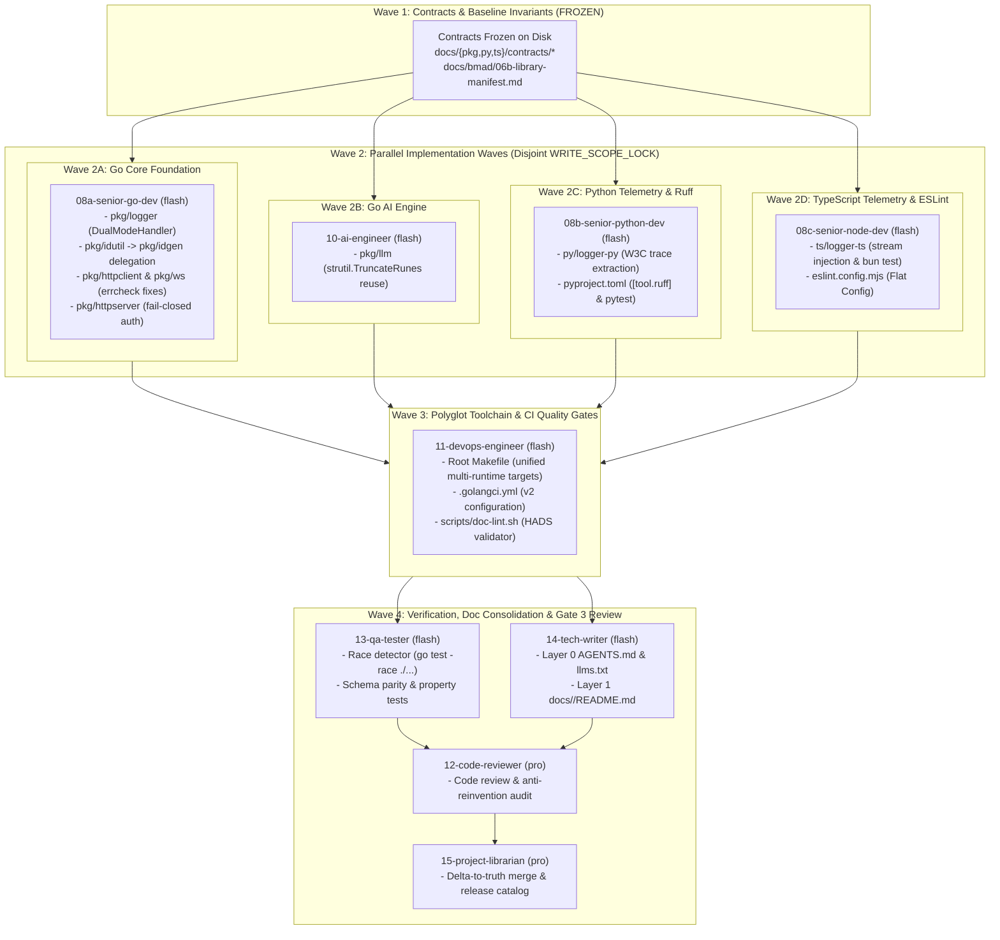

# Master Execution Plan: Polyglot Foundation Engineering Platform (`core-kit`)

**Document ID**: `BMAD-PLAN-07-CORE-KIT`  
**Version**: `1.0.0`  
**Status**: `APPROVED FOR EXECUTION`  
**Author**: Role 07: Principal Technical Lead & Detailed Implementation Planner (`07-tech-lead` / `model: pro`)  
**Predecessor Documents**: [`docs/bmad/02-prd.md`](file:///home/dangnmh/work/core-kit/docs/bmad/02-prd.md), [`docs/bmad/03-ui-ux-spec.md`](file:///home/dangnmh/work/core-kit/docs/bmad/03-ui-ux-spec.md), [`docs/bmad/04-architecture.md`](file:///home/dangnmh/work/core-kit/docs/bmad/04-architecture.md), [`docs/bmad/05-database-spec.md`](file:///home/dangnmh/work/core-kit/docs/bmad/05-database-spec.md), [`docs/bmad/06-security-spec.md`](file:///home/dangnmh/work/core-kit/docs/bmad/06-security-spec.md), [`docs/bmad/06b-library-manifest.md`](file:///home/dangnmh/work/core-kit/docs/bmad/06b-library-manifest.md), [`docs/adr/ADR-001`](file:///home/dangnmh/work/core-kit/docs/adr/ADR-001-unified-polyglot-logging.md), [`ADR-002`](file:///home/dangnmh/work/core-kit/docs/adr/ADR-002-websocket-architecture.md), [`ADR-003`](file:///home/dangnmh/work/core-kit/docs/adr/ADR-003-polyglot-linter-and-ci-toolchain.md)  
**Target Execution Agents**: `08a-senior-go-dev`, `08b-senior-python-dev`, `08c-senior-node-dev`, `10-ai-engineer`, `11-devops-engineer`, `12-code-reviewer`, `13-qa-tester`, `14-tech-writer`, `15-project-librarian`  
**Date**: 2026-10-16  

---

## 1. Executive Summary & Zero-Guesswork Philosophy

This Master Execution Plan establishes the byte-level implementation roadmap to transition `core-kit` from its current state into an enterprise-grade polyglot foundation platform satisfying 100% of the BMAD 4-Layer HADS Documentation Standard, unified cross-language telemetry parity, zero technical debt, and zero-data-race concurrency.

Downstream execution agents running on the fast, low-cost **`flash` model** receive self-contained, bite-sized tasks with **zero prior context required**, **zero architectural guesswork permitted**, and **strict disjoint file boundaries (`WRITE_SCOPE_LOCK`)**. Every dependency, verified API signature, struct definition, and TDD step is pre-calculated from `docs/bmad/06b-library-manifest.md` and frozen contracts.

---

## 2. Master Implementation Waves DAG

The implementation is structured into 4 sequential and parallel waves to maximize throughput while guaranteeing conflict-free file modifications:

---

## 3. Dynamic Language Routing & Agent Assignment Matrix

In strict accordance with the BMAD dynamic routing rules, execution agents are dispatched by component manifest and domain specialization:

| Component Path | Primary Manifest | Language / Stack | Assigned Specialist Agent | Model Tier | Task Specification Link |
| :--- | :--- | :--- | :--- | :---: | :--- |
| **`pkg/*`** (core) | `go.mod` | Go 1.27.1+ | **`08a-senior-go-dev`** | `flash` | [`sprint-1-core-standardization.md`](file:///home/dangnmh/work/core-kit/docs/pkg/tasks/sprint-1-core-standardization.md) |
| **`pkg/llm`** | `go.mod` | Go 1.27.1+ | **`10-ai-engineer`** | `flash` | [`sprint-1-core-standardization.md`](file:///home/dangnmh/work/core-kit/docs/pkg/tasks/sprint-1-core-standardization.md) |
| **`py/logger-py`** | `pyproject.toml` | Python 3.10–3.14+ | **`08b-senior-python-dev`** | `flash` | [`sprint-1-logger-and-ruff.md`](file:///home/dangnmh/work/core-kit/docs/py/tasks/sprint-1-logger-and-ruff.md) |
| **`ts/logger-ts`** | `package.json` | TypeScript / Bun 1.4+ | **`08c-senior-node-dev`** | `flash` | [`sprint-1-logger-and-eslint.md`](file:///home/dangnmh/work/core-kit/docs/ts/tasks/sprint-1-logger-and-eslint.md) |
| **Root Toolchain** | `Makefile`, `.golangci.yml` | Make, Shell, YAML | **`11-devops-engineer`** | `flash` | [`story-04-polyglot-toolchain-and-doc-governance.md`](file:///home/dangnmh/work/core-kit/docs/bmad/stories/story-04-polyglot-toolchain-and-doc-governance.md) |
| **HADS Docs Suite** | Markdown, `scripts/` | HADS 1.0, Shell | **`14-tech-writer`** | `flash` | [`story-04-polyglot-toolchain-and-doc-governance.md`](file:///home/dangnmh/work/core-kit/docs/bmad/stories/story-04-polyglot-toolchain-and-doc-governance.md) |
| **Code Review Gate**| Repository-wide | Multi-language | **`12-code-reviewer`** | `pro` | N/A (Gatekeeper) |
| **QA Verification** | Repository-wide | Multi-language | **`13-qa-tester`** | `flash` | N/A (Test suite execution) |
| **PMO & Catalog** | Monorepo root | Governance | **`15-project-librarian`** | `pro` | N/A (Release finalization) |

---

## 4. Strict Disjoint File Write Boundaries (`WRITE_SCOPE_LOCK`)

To prevent git merge conflicts and context contamination across parallel subagents, each agent holds exclusive ownership of designated paths:

| Assigned Agent | Subsystem / Component | Permitted File Modification Paths (`WRITE_SCOPE_LOCK`) | Forbidden Paths |
| :--- | :--- | :--- | :--- |
| **`08a-senior-go-dev`** | Go Foundation | `pkg/logger/*` `pkg/idutil/*` `pkg/idgen/*` `pkg/httpclient/*` `pkg/ws/*` `pkg/httpserver/*` | `pkg/llm/*`, `py/*`, `ts/*`, `Makefile`, root docs |
| **`10-ai-engineer`** | Go AI Engine | `pkg/llm/*` | All other `pkg/*`, `py/*`, `ts/*`, root docs |
| **`08b-senior-python-dev`**| Python Telemetry | `py/logger-py/*` | `pkg/*`, `ts/*`, `Makefile`, root docs |
| **`08c-senior-node-dev`** | TypeScript Telemetry | `ts/logger-ts/*` | `pkg/*`, `py/*`, `Makefile`, root docs |
| **`11-devops-engineer`** | Root Toolchain & CI | `Makefile` `.golangci.yml` `scripts/doc-lint.sh` | `pkg/*`, `py/*`, `ts/*`, `docs/*` (except scripts) |
| **`14-tech-writer`** | Documentation | `AGENTS.md` `llms.txt` `README.md` `CHANGELOG.md` `docs/pkg/README.md` `docs/py/README.md` `docs/ts/README.md` | Source code files, `Makefile`, `.golangci.yml` |

---

## 5. Traceability Matrix

Every requirement across PRD, Architecture, ADRs, Security, and Stories is tracked below:

| PRD Feature ID | Architecture Ref | ADR Ref | Security Control | Target Story / Sprint Task | Verification Standard |
| :--- | :--- | :--- | :--- | :--- | :--- |
| **TEL-01** (Go Slog Parity) | `CONST-03`, Sec 2.1 | `ADR-001` | `CONST-SEC-03`, `06` | Story 01 / `sprint-1-core-standardization` | `go test -v -race ./pkg/logger` |
| **TEL-02** (Python Parity) | `CONST-03`, Sec 2.2 | `ADR-001` | `CONST-SEC-03`, `06` | Story 02 / `sprint-1-logger-and-ruff` | `uv run pytest py/logger-py/tests` |
| **TEL-03** (TS Parity & Stream)| `CONST-03`, Sec 2.3 | `ADR-001` | `CONST-SEC-03`, `06` | Story 03 / `sprint-1-logger-and-eslint` | `cd ts/logger-ts && bun test` |
| **CR-01** (`idgen` / `idutil`) | `CONST-02`, Sec 2.1 | `ADR-003` | `CONST-SEC-05` | Story 01 / `sprint-1-core-standardization` | `go test ./pkg/idutil ./pkg/idgen` |
| **CR-02** (`llm` Truncation) | `CONST-02`, Sec 2.1 | `ADR-003` | N/A | Story 01 / `sprint-1-core-standardization` | `go test -v ./pkg/llm` |
| **CR-03** (`httpclient` Close) | `CONST-02`, Sec 2.1 | `ADR-003` | `CONST-SEC-04` | Story 01 / `sprint-1-core-standardization` | `golangci-lint run ./pkg/httpclient` |
| **CR-04** (`ws` Conn Close) | `CONST-04`, Sec 2.1 | `ADR-002` | `CONST-SEC-04` | Story 01 / `sprint-1-core-standardization` | `golangci-lint run ./pkg/ws` |
| **SEC-01** (Fail-Closed Auth) | `CONST-06`, Sec 2.1 | N/A | `CONST-SEC-01`, `02` | Story 01 / `sprint-1-core-standardization` | `go test -v ./pkg/httpserver` |
| **TOOL-01** (Unified Makefile) | `CONST-08`, Sec 2.1 | `ADR-003` | N/A | Story 04 / `story-04-polyglot-toolchain` | `make test && make lint && make fmt` |
| **DOC-01..04** (HADS 1.0 Docs) | `CONST-08`, Sec 2.1 | `ADR-003` | N/A | Story 04 / `story-04-polyglot-toolchain` | `make doc-lint` (0 errors, 0 broken links) |

---

## 6. Risk Management, Rollback & Blast Radius Assessment

| Risk Description | Probability | Severity | Blast Radius | Mitigation & Rollback Procedure |
| :--- | :---: | :---: | :---: | :--- |
| **Legacy Ingestor Breakage on Go Logs** | Medium | High | Downstream log parsers in `realtime-gateway` | `pkg/logger` incorporates `LOG_LEGACY_FLAT=true` environment variable to emit both root-level and nested attributes simultaneously. Rollback: set env var. |
| **Bun Test Runner Disruption** | Low | Medium | TS developer workflow | Avoid monkey-patching `process.stdout.write`. Inject custom in-memory stream into `LoggerOptions.stream`. |
| **Breaking External Imports on `idutil`** | Low | High | External consumers importing `pkg/idutil` | Preserve `pkg/idutil` with exact type/function signatures aliased to `pkg/idgen`. Add `@deprecated` doc comment. |
| **Python Virtual Environment Incompatibility** | Low | Medium | Local developer environment | Rely on `uv run pytest` and `uv run ruff check` which auto-manage the virtual environment without hardcoded workstation paths. |
| **Markdown Link Drift in CI** | Medium | Low | CI build failure | Automated `scripts/doc-lint.sh` script runs locally via `make doc-lint` before committing. |

---

## 7. Quality Gates & Definition of Done (Gate 3 Checklist)

The platform passes Gate 3 and enters production readiness ONLY when all the following conditions evaluate to TRUE:

- [ ] `go test -race ./...` exits with code 0 across all 34 packages.
- [ ] `cd ts/logger-ts && bun test` exits with code 0 without silenced reporter output.
- [ ] `cd py/logger-py && uv run pytest tests -v` exits with code 0.
- [ ] `golangci-lint run ./...` with `.golangci.yml` v2 passes with 0 errors and 0 warnings (0 `errcheck` violations).
- [ ] `cd py/logger-py && uv run ruff check .` passes with 0 warnings.
- [ ] `cd ts/logger-ts && bun lint` passes with 0 errors.
- [ ] `make doc-lint` exits with code 0 (all Layer 0 and Layer 1 documents `<= 120 lines`, 0 broken links).
- [ ] Code Reviewer (`12-code-reviewer`) issues formal approval with 0 "Do Not Hand-Roll" violations.
- [ ] Project Librarian (`15-project-librarian`) confirms catalog consolidation and archives release notes.

---

## 🔗 Downstream Agent Handoff

### 1. Directives for `08a-senior-go-dev`
- **Mandatory Specification**: [`docs/pkg/tasks/sprint-1-core-standardization.md`](file:///home/dangnmh/work/core-kit/docs/pkg/tasks/sprint-1-core-standardization.md) and [`docs/bmad/stories/story-01-core-go-standardization.md`](file:///home/dangnmh/work/core-kit/docs/bmad/stories/story-01-core-go-standardization.md).
- **Files to Modify**: `pkg/logger/*`, `pkg/idutil/*`, `pkg/httpclient/*`, `pkg/ws/*`, `pkg/httpserver/*`.
- **Scope Restriction**: Do NOT touch `pkg/llm/*`, `py/*`, `ts/*`, or root files.

### 2. Directives for `10-ai-engineer`
- **Mandatory Specification**: [`docs/bmad/stories/story-01-core-go-standardization.md`](file:///home/dangnmh/work/core-kit/docs/bmad/stories/story-01-core-go-standardization.md) (Task 1.3).
- **Files to Modify**: `pkg/llm/extractor.go`, `pkg/llm/extractor_test.go`.
- **Verification**: `go test -v ./pkg/llm`.

### 3. Directives for `08b-senior-python-dev`
- **Mandatory Specification**: [`docs/py/tasks/sprint-1-logger-and-ruff.md`](file:///home/dangnmh/work/core-kit/docs/py/tasks/sprint-1-logger-and-ruff.md) and [`docs/bmad/stories/story-02-python-logger-parity-and-ruff.md`](file:///home/dangnmh/work/core-kit/docs/bmad/stories/story-02-python-logger-parity-and-ruff.md).
- **Files to Modify**: `py/logger-py/pyproject.toml`, `py/logger-py/logger_py/formatter.py`, `py/logger-py/tests/test_logger.py`.
- **Verification**: `uv run pytest py/logger-py/tests` and `uv run ruff check py/logger-py`.

### 4. Directives for `08c-senior-node-dev`
- **Mandatory Specification**: [`docs/ts/tasks/sprint-1-logger-and-eslint.md`](file:///home/dangnmh/work/core-kit/docs/ts/tasks/sprint-1-logger-and-eslint.md) and [`docs/bmad/stories/story-03-typescript-logger-parity-and-eslint.md`](file:///home/dangnmh/work/core-kit/docs/bmad/stories/story-03-typescript-logger-parity-and-eslint.md).
- **Files to Modify**: `ts/logger-ts/package.json`, `ts/logger-ts/eslint.config.mjs`, `ts/logger-ts/src/types.ts`, `ts/logger-ts/src/index.ts`, `ts/logger-ts/tests/logger.test.ts`.
- **Verification**: `cd ts/logger-ts && bun test` and `cd ts/logger-ts && bun lint`.

### 5. Directives for `11-devops-engineer`
- **Mandatory Specification**: [`docs/bmad/stories/story-04-polyglot-toolchain-and-doc-governance.md`](file:///home/dangnmh/work/core-kit/docs/bmad/stories/story-04-polyglot-toolchain-and-doc-governance.md).
- **Files to Modify**: `Makefile`, `.golangci.yml`, `scripts/doc-lint.sh`.
- **Verification**: `make test`, `make lint`, `make fmt`, `make doc-lint`.
