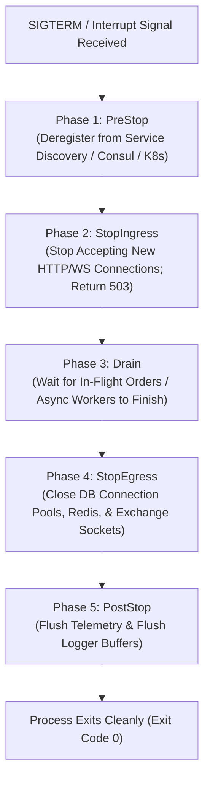
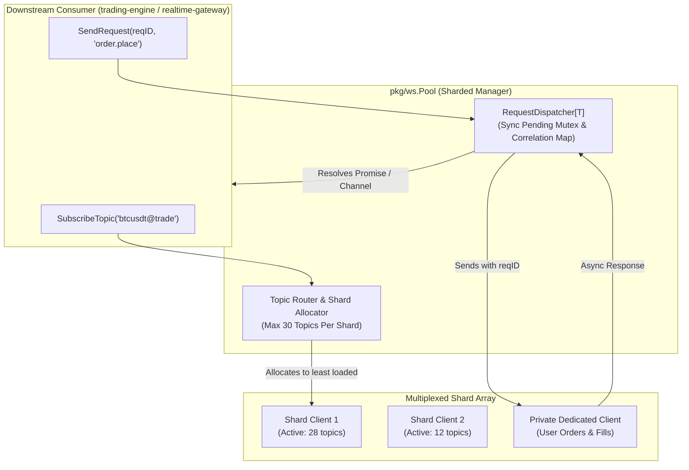

# Go Foundation Architecture & Component Specification (`docs/pkg/architecture.md`)
**Version 1.0.0** · Core Infrastructure Team · 2026-10-16 · Standard: HADS 1.0.0

---

## AI READING INSTRUCTION

Read `**[SPEC]**` blocks for internal subsystem boundaries, package trees, and concurrency designs.
Read `**[BUG]**` blocks before modifying lock ordering, buffer pointers, or shutdown lifecycle hooks.
Read `**[NOTE]**` blocks for design rationale and consumer service context.

---

## 1. COMPONENT INTERNAL DESIGN & PACKAGE TREE

**[SPEC]**
The Go foundation component (`pkg/*`) is a stateless, pure-compute library monorepo containing 34 packages structured into 7 functional domains:

```text
pkg/
├── telemetry/
│   ├── logger/        # slog DualModeHandler, RFC3339 JSON, context grouping
│   ├── tracer/        # OpenTelemetry W3C traceparent injector & extractor
│   ├── httplog/       # HTTP request/response logger with PII sanitization
│   └── tracectx/      # Request ID context propagation (x-request-id)
├── networking/
│   ├── httpserver/    # Gin engine, Bearer auth panic, MaxBytes 10MB middleware
│   ├── httpclient/    # Resilient HTTP client pool, retry, proxy support
│   ├── ws/            # Multiplexed sharded WebSocket connection pool & RPC dispatcher
│   ├── wsclient/      # Event-driven WebSocket client wrapper
│   └── wsserver/      # High-concurrency broadcast WebSocket server
├── resilience/
│   ├── resilience/    # Gobreaker circuit breaker & Cenkalti full-jitter backoff
│   ├── ratelimit/     # Token-bucket rate limiter with tier-based path weighting
│   ├── ticker/        # Context-aware periodic ticker loop with uniform jitter
│   ├── eventbus/      # In-memory Watermill pub/sub bus with deduplication
│   └── lifecycle/     # 5-phase coordinated graceful shutdown manager
├── datastructures/
│   ├── ringbuffer/    # Thread-safe generic O(1) circular ring buffer with sequence index
│   ├── safemap/       # RWMutex-backed generic concurrent map with atomic compute
│   ├── ttlcache/      # In-memory key-value cache with per-item TTL and janitor
│   ├── priorityqueue/ # Thread-safe generic binary Min/Max heap
│   └── quadtree/      # 2D spatial indexing quadtree for proximity searches
├── math/
│   ├── decmath/       # Arbitrary precision decimal tick floor/ceil snapping
│   └── tradecalc/     # Slippage, fee, and order quantity sizing calculations
├── config/
│   ├── bootstrap/     # MustLoad fail-fast environment & file validator
│   ├── config/        # JSONC parser with environment variable interpolation
│   └── version/       # Semantic build version and commit metadata
└── utils/
    ├── idgen/         # Cryptographic CSPRNG nanoid and prefixed ID generator
    ├── idutil/        # Backward-compatible alias delegating to pkg/idgen
    ├── jsonutil/      # Standard JSON encoder/decoder helper
    ├── xjson/         # Extended JSON codec for strict numeric types and RFC3339
    ├── maputil/       # Panic-free type-safe map accessor utilities
    ├── strutil/       # Rune-aware string truncation and sanitization
    ├── ptr/           # Generic pointer conversion utilities
    └── types/         # Custom Duration and scalar utility types
```

---

## 2. CONCURRENCY & SUBSYSTEM WORKFLOWS

### 2.1 5-Phase Graceful Shutdown Lifecycle (`pkg/lifecycle`)

**[SPEC]**
All long-running daemon processes coordinate through `pkg/lifecycle.Manager` across 5 sequential phases (`CONST-07`):



### 2.2 Sharded Multiplexed WebSocket Pool & RPC Dispatcher (`pkg/ws`)

**[SPEC]**
Manages high-throughput market streams across external exchanges subject to subscription limits (`ADR-002`):



---

## 3. DATA STRUCTURES & RINGBUFFER MONOTONIC WINDOW

**[SPEC]**
`pkg/ringbuffer.RingBuffer[T]` implements a zero-alloc circular queue protected by `sync.RWMutex`:
- Head pointer advances modulo buffer capacity: `head = (head + 1) % capacity`.
- Sequence IDs strictly increment per write: `seqCounter++`.
- `Since(seq int64)` extracts records where `record.seq > seq` in chronological order without dynamic reallocation.

```mermaid
stateDiagram-v2
    [*] --> Initialized: New[T](capacity)
    Initialized --> Writing: Push(item)
    Writing --> Writing: head = (head + 1) % cap; size = min(size + 1, cap)
    Writing --> WindowQuery: Since(seq int64)
    WindowQuery --> Writing: Read slice [head-n .. head] under RLock
```



---

## 4. INVARIANTS & SECURITY BOUNDARIES

**[SPEC]**
1. **Memory Cap**: `httpserver.MaxBytesMiddleware` limits inbound HTTP requests to 10MB (`CONST-SEC-04`).
2. **Fail-Closed Auth**: `httpserver.BearerTokenAuth` halts binary startup via `panic` if secret token is missing (`CONST-SEC-01`).
3. **Entropy Failure Fast-Panic**: `idgen.NewPrefixedID` aborts via `panic` on `rand.Read` system failure (`CONST-SEC-05`).
4. **Zero Float Drift**: `decmath` executes all market tick math using `decimal.Decimal` (`CONST-05`).
