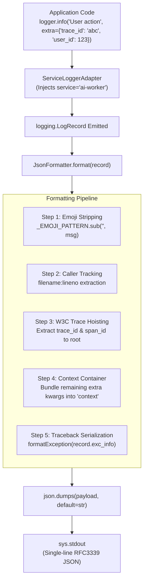
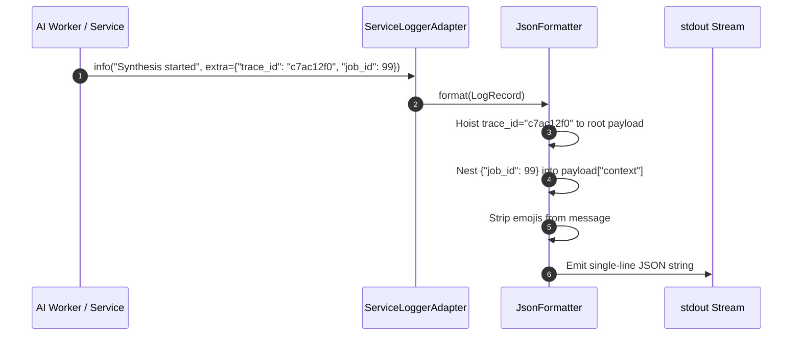

# Python Telemetry Architecture & Formatting Pipeline (`docs/py/architecture.md`)
**Version 1.0.0** · Telemetry & Observability Team · 2026-10-16 · Standard: HADS 1.0.0

---

## AI READING INSTRUCTION

Read `**[SPEC]**` blocks for internal subsystem boundaries, record formatting flows, and trace hoisting.
Read `**[BUG]**` blocks before modifying regex filters, record dictionary extraction, or stream handlers.
Read `**[NOTE]**` blocks for cross-runtime correlation context.

---

## 1. COMPONENT INTERNAL DESIGN & PACKAGE TREE

**[SPEC]**
The Python telemetry package (`py/logger-py`) provides structured JSON logging with zero external runtime dependencies:

```text
py/logger-py/
├── logger_py/
│   ├── __init__.py          # Public exports: setup_logging, get_logger, JsonFormatter, ServiceLoggerAdapter
│   └── formatter.py         # JsonFormatter, emoji stripping regex, trace hoister, exception serializer
├── tests/
│   ├── __init__.py
│   └── test_logger.py       # 10 comprehensive unit tests covering formatting, hoisting, and adapters
└── pyproject.toml           # Project manifest, Ruff linter rules, Pytest configuration
```

---

## 2. RECORD PROCESSING PIPELINE & WORKFLOW

**[SPEC]**
The `JsonFormatter` executes a deterministic transformation pipeline on each Python `logging.LogRecord`:



---

## 3. SEQUENCE DIAGRAM: CONTEXT & TRACE PROPAGATION

**[SPEC]**
When downstream workers process distributed requests, trace IDs propagate to root level:



---

## 4. INVARIANTS & SECURITY BOUNDARIES

**[SPEC]**
1. **Zero Emojis (`CONST-07`)**: Unfiltered emojis or unicode symbols are stripped via regex before serialization.
2. **Schema Parity (`CONST-03`)**: Root fields strictly match Go (`pkg/logger`) and TypeScript (`ts/logger-ts`) schemas.
3. **Log Injection Immunity (`CONST-SEC-06`)**: Messages and contexts are safely serialized via `json.dumps`, preventing CRLF log injection.
