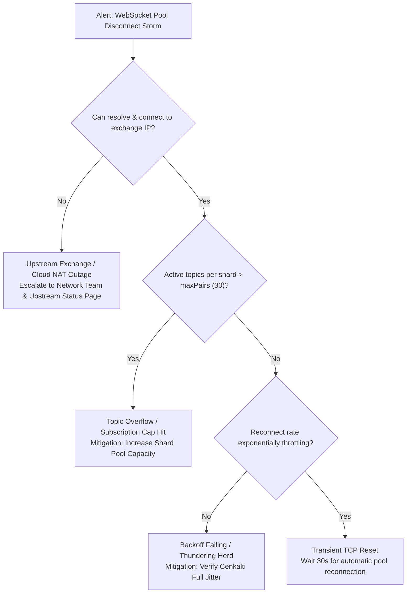

# Runbook 01: WebSocket Pool Shard Disconnection & Reconnect Storm

**Document ID**: `RB-01-WS-RECONNECT-STORM`  
**Service / Component**: `pkg/ws`, `pkg/wsclient`, `pkg/wsserver`  
**Severity**: `SEV-2 (High)`  
**On-Call Role**: SRE / Platform Engineer  
**Date**: 2026-10-16 · Standard: SRE Incident Playbook

---

## 1. DETECTION SIGNAL & SYMPTOMS

- **Alert Name**: `WebSocketPoolShardDisconnectHigh` / `WebSocketReconnectStorm`
- **PromQL / Metric**:
  ```promql
  sum(rate(websocket_shard_reconnect_attempts_total[2m])) by (service, shard_id) > 5
  ```
- **Log Pattern**:
  ```json
  {"severity":"WARN","logger":"ws.pool","message":"Shard connection severed; initiating backoff reconnect"}
  ```
- **Customer Impact**: Real-time market tick delay in `realtime-gateway` / `trading-engine`; temporary price staleness.

---

## 2. FIRST 60 SECONDS DIAGNOSTICS (READ-ONLY)

Execute these read-only inspection commands to evaluate the blast radius:

```bash
# 1. Check container pod logs for WebSocket disconnect reason
kubectl logs -l app=realtime-gateway --tail=100 | grep -E "ws\.pool|reconnect|EOF|close 1006"

# 2. Inspect active shard connection status and topic distribution
curl -s http://localhost:8080/debug/ws/pool | jq '.shards[] | {shard_id, state, active_topics, reconnect_count}'

# 3. Verify outbound network connectivity to exchange WebSocket gateway
nc -zv stream.binance.com 9443
```

---

## 3. TRIAGE DECISION TREE



---

## 4. MITIGATION & RECOVERY ACTIONS

### Mitigation A: Scale Shard Pool Capacity (Dynamic Re-balancing)
If subscriptions exceed exchange limits (`maxPairs = 30` per connection):
- **Command** (`⚠️ changes state`):
  ```bash
  kubectl patch configmap core-service-config --type merge -p '{"data":{"WS_MAX_PAIRS_PER_SHARD":"20"}}'
  kubectl rollout restart deployment/realtime-gateway
  ```
- **Blast Radius**: Rolling pod restart; active connections migrate smoothly across new shards.
- **Rollback**:
  ```bash
  kubectl rollout undo deployment/realtime-gateway
  ```

### Mitigation B: Drain and Reconnect Degraded Shard
If a single shard is stuck in half-open state:
- **Command** (`⚠️ changes state`):
  ```bash
  curl -X POST http://localhost:8080/debug/ws/pool/restart-shard?id=shard-02
  ```
- **Confirmation Check**: Verify shard reconnects with HTTP 200 within 5 seconds.

---

## 5. ESCALATION PATH & VERIFICATION

1. **Escalation**:
   - Secondary on-call: `#infra-oncall` Slack channel / PagerDuty schedule `Core-Infra-Escalation`.
   - External Exchange Liaison if Binance/OKX indicates API maintenance.
2. **Resolution Verification**:
   - Verify `sum(rate(websocket_shard_reconnect_attempts_total[5m])) == 0`.
   - Verify tick latency drops below 50ms in Grafana dashboard `Market Data Feeds`.
