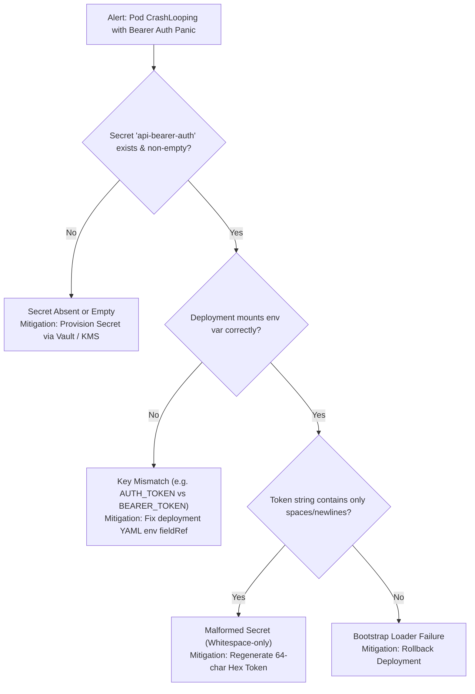

# Runbook 02: Bearer Authentication Fail-Closed Startup Panic

**Document ID**: `RB-02-BEARER-AUTH-STARTUP-PANIC`  
**Service / Component**: `pkg/httpserver` (`CONST-SEC-01`)  
**Severity**: `SEV-1 (Critical)`  
**On-Call Role**: SRE / Application On-Call  
**Date**: 2026-10-16 · Standard: SRE Incident Playbook

---

## 1. DETECTION SIGNAL & SYMPTOMS

- **Alert Name**: `KubePodCrashLooping` / `ServiceStartupPanic`
- **PromQL / Metric**:
  ```promql
  rate(kube_pod_container_status_restarts_total{container="api"}[5m]) > 0
  ```
- **Log Pattern**:
  ```text
  panic: auth: bearer token must not be empty or whitespace (CONST-SEC-01)
  goroutine 1 [running]:
  github.com/dangnmh/core-kit/pkg/httpserver.BearerTokenAuth({0x0, 0x0})
      /pkg/httpserver/auth.go:14 +0x45
  ```
- **Customer Impact**: Service is offline; Kubernetes reports 0 ready replicas; incoming HTTP requests return 502 Bad Gateway.

---

## 2. FIRST 60 SECONDS DIAGNOSTICS (READ-ONLY)

Inspect the crashing pod and verify secret injection:

```bash
# 1. Read last termination log and stack trace
kubectl logs deployment/api-server -c api --previous --tail=30

# 2. Check if the required secret exists in the cluster namespace
kubectl get secret api-bearer-auth -o jsonpath='{.data.BEARER_TOKEN}' | base64 -d

# 3. Check deployment manifest environment variable bindings
kubectl get deployment api-server -o yaml | grep -A 5 -B 2 "BEARER_TOKEN"
```

---

## 3. TRIAGE DECISION TREE



---

## 4. MITIGATION & RECOVERY ACTIONS

### Mitigation A: Restore Missing or Blank Bearer Secret
If the secret was deleted or contains an empty string:
- **Command** (`⚠️ changes state`):
  ```bash
  # Generate cryptographically secure token and inject
  SEC_VAL=$(openssl rand -hex 32)
  kubectl create secret generic api-bearer-auth --from-literal=BEARER_TOKEN="${SEC_VAL}" --dry-run=client -o yaml | kubectl apply -f -
  kubectl rollout restart deployment/api-server
  ```
- **Blast Radius**: Pods will pick up new token immediately and enter `Running` state.
- **Rollback**:
  ```bash
  kubectl rollout undo deployment/api-server
  ```

### Mitigation B: Fix Deployment Environment Variable Mapping
If the deployment referenced the wrong secret key:
- **Command** (`⚠️ changes state`):
  ```bash
  kubectl set env deployment/api-server BEARER_TOKEN="secretKeyRef:name=api-bearer-auth,key=BEARER_TOKEN"
  ```
- **Confirmation Check**:
  ```bash
  kubectl rollout status deployment/api-server --timeout=60s
  ```

---

## 5. ESCALATION PATH & VERIFICATION

1. **Escalation**:
   - Security On-Call: `#sec-ops` Slack channel / PagerDuty `Security-Engineering`.
   - Core Platform Lead if panic occurs despite valid non-empty token string.
2. **Resolution Verification**:
   - `kubectl get pods -l app=api-server` reports `1/1 Running`.
   - Send test authenticated health probe:
     ```bash
     curl -s -H "Authorization: Bearer ${BEARER_TOKEN}" http://api.internal/healthz
     # Expected: HTTP 200 OK
     ```
