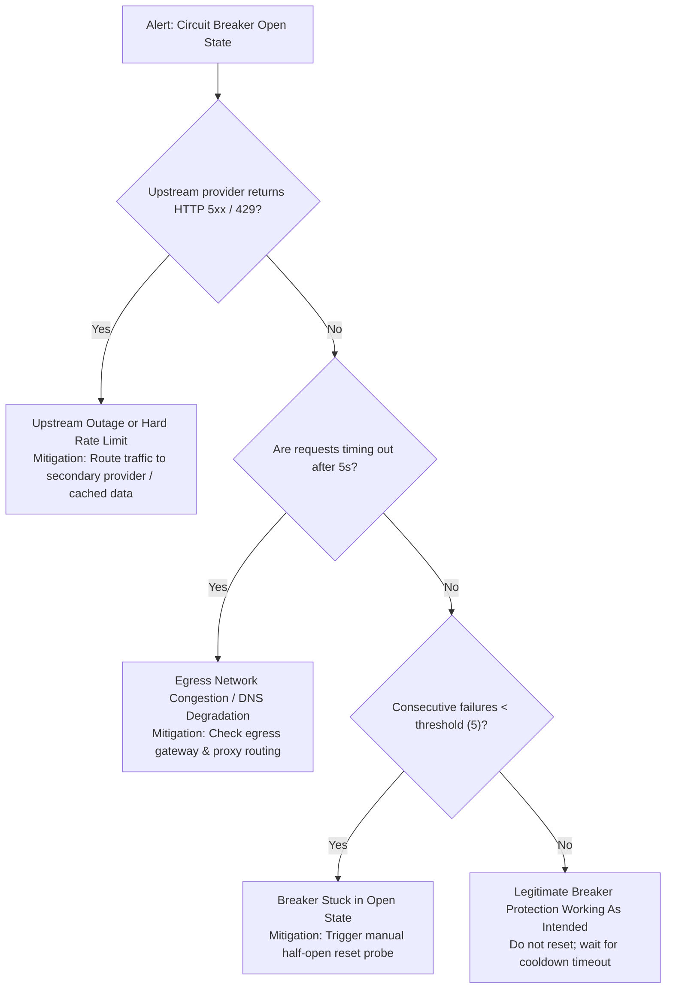

# Runbook 03: Circuit Breaker Open-State Cascade & Rate Limiter Saturation

**Document ID**: `RB-03-CIRCUIT-BREAKER-CASCADE`  
**Service / Component**: `pkg/resilience`, `pkg/ratelimit`, `pkg/httpclient`  
**Severity**: `SEV-2 (High)`  
**On-Call Role**: SRE / Application On-Call  
**Date**: 2026-10-16 · Standard: SRE Incident Playbook

---

## 1. DETECTION SIGNAL & SYMPTOMS

- **Alert Name**: `CircuitBreakerStateOpen` / `ExchangeRateLimitExhaustion`
- **PromQL / Metric**:
  ```promql
  sum(rate(resilience_circuit_breaker_rejections_total[2m])) by (breaker_name) > 10
  ```
- **Log Pattern**:
  ```json
  {"severity":"ERROR","logger":"httpclient","message":"Circuit breaker rejected call: breaker is in open state","error":"circuit breaker is open"}
  ```
- **Customer Impact**: Outbound requests to downstream providers (e.g. OpenAI API, Binance REST) fail fast; degraded service mode active.

---

## 2. FIRST 60 SECONDS DIAGNOSTICS (READ-ONLY)

Inspect breaker telemetry and external upstream status:

```bash
# 1. Query circuit breaker status endpoint
curl -s http://localhost:8080/debug/resilience/breakers | jq '.[] | {name, state, failure_ratio, consecutive_failures}'

# 2. Check rate limiter token bucket levels
curl -s http://localhost:8080/debug/ratelimit/status | jq '.tiers[] | {endpoint, available_tokens, wait_time_ms}'

# 3. Test raw HTTP latency to upstream provider bypass breaker
curl -o /dev/null -s -w 'HTTP Code: %{http_code} | Total Time: %{time_total}s\n' https://api.binance.com/api/v3/ping
```

---

## 3. TRIAGE DECISION TREE



---

## 4. MITIGATION & RECOVERY ACTIONS

### Mitigation A: Failover to Secondary Upstream Provider
If the primary exchange or LLM endpoint is degraded:
- **Command** (`⚠️ changes state`):
  ```bash
  kubectl patch configmap ai-worker-config --type merge -p '{"data":{"PRIMARY_LLM_PROVIDER":"anthropic","FALLBACK_PROVIDER":"openai"}}'
  kubectl rollout restart deployment/ai-worker
  ```
- **Blast Radius**: Traffic diverts to secondary endpoint immediately.
- **Rollback**:
  ```bash
  kubectl rollout undo deployment/ai-worker
  ```

### Mitigation B: Reset Stuck Circuit Breaker (Manual Half-Open Probe)
If the upstream has completely recovered but breaker cooldown timer is prolonged:
- **Command** (`⚠️ changes state`):
  ```bash
  curl -X POST http://localhost:8080/debug/resilience/breakers/reset?name=binance-rest-breaker
  ```
- **Confirmation Check**: Verify breaker state changes from `Open` to `HalfOpen`, followed by `Closed` on next successful request.

---

## 5. ESCALATION PATH & VERIFICATION

1. **Escalation**:
   - Secondary on-call: `#infra-oncall` Slack channel / PagerDuty `Core-Infra-Escalation`.
   - Upstream API Provider Support if 5xx persists beyond 15 minutes.
2. **Resolution Verification**:
   - Verify `resilience_circuit_breaker_state{name="binance-rest-breaker"} == 0` (0 = Closed).
   - Rejection metric drops to 0: `sum(rate(resilience_circuit_breaker_rejections_total[5m])) == 0`.
