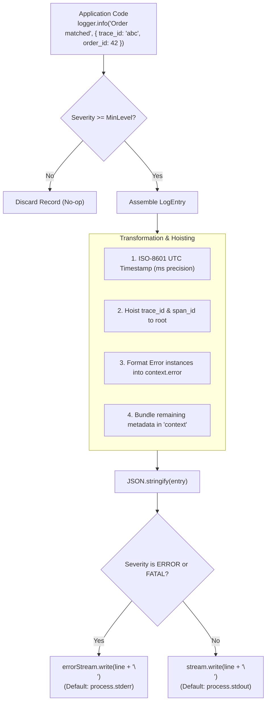
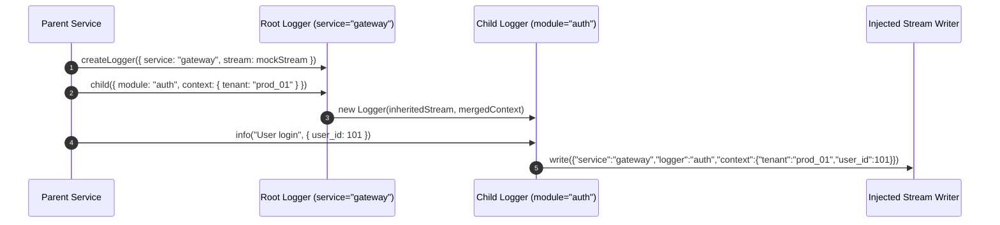

# TypeScript & Bun Telemetry Architecture (`docs/ts/architecture.md`)
**Version 1.0.0** · Telemetry & Observability Team · 2026-10-16 · Standard: HADS 1.0.0

---

## AI READING INSTRUCTION

Read `**[SPEC]**` blocks for internal subsystem boundaries, stream routing rules, and trace hoisting.
Read `**[BUG]**` blocks before modifying stream injection, child logger inheritance, or level thresholds.
Read `**[NOTE]**` blocks for cross-runtime correlation context.

---

## 1. COMPONENT INTERNAL DESIGN & PACKAGE TREE

**[SPEC]**
The TypeScript telemetry library (`ts/logger-ts`) provides structured JSON logging natively in Bun 1.1+ and Node.js 20+:

```text
ts/logger-ts/
├── src/
│   ├── index.ts             # Logger class, createLogger factory, level mapping, stream writer
│   └── types.ts             # ILogger, LogLevel, LogEntry, LoggerOptions, ChildLoggerOptions
├── tests/
│   └── logger.test.ts       # 11 comprehensive Bun test specs verifying schema, streams, and trace hoisting
├── eslint.config.mjs        # ESLint 9 Flat Config with typescript-eslint
├── package.json             # Manifest, workspace export, lint/test scripts
└── tsconfig.json            # Strict TypeScript configuration (noImplicitAny, strictNullChecks)
```

---

## 2. STREAM ROUTING & LOGGING PIPELINE

**[SPEC]**
`Logger.write` processes log records through level validation, trace hoisting, and stream selection:



---

## 3. SEQUENCE DIAGRAM: CHILD LOGGER CONTEXT INHERITANCE

**[SPEC]**
Child loggers inherit parent configuration and stream destinations without process-wide globals:



---

## 4. INVARIANTS & SECURITY BOUNDARIES

**[SPEC]**
1. **Zero Global Mutability (`AC-TS-3.1`)**: Loggers never monkey-patch `process.stdout` or `process.stderr`. All destinations are cleanly passed via options.
2. **Schema Parity (`CONST-03`)**: Emitted JSON keys match Go (`pkg/logger`) and Python (`py/logger-py`) schemas 100%.
3. **Trace Hoisting (`AC-TS-3.3`)**: OpenTelemetry trace and span identifiers are extracted to top-level keys for instant log correlation.
